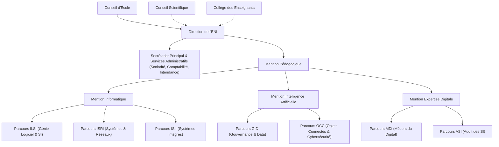
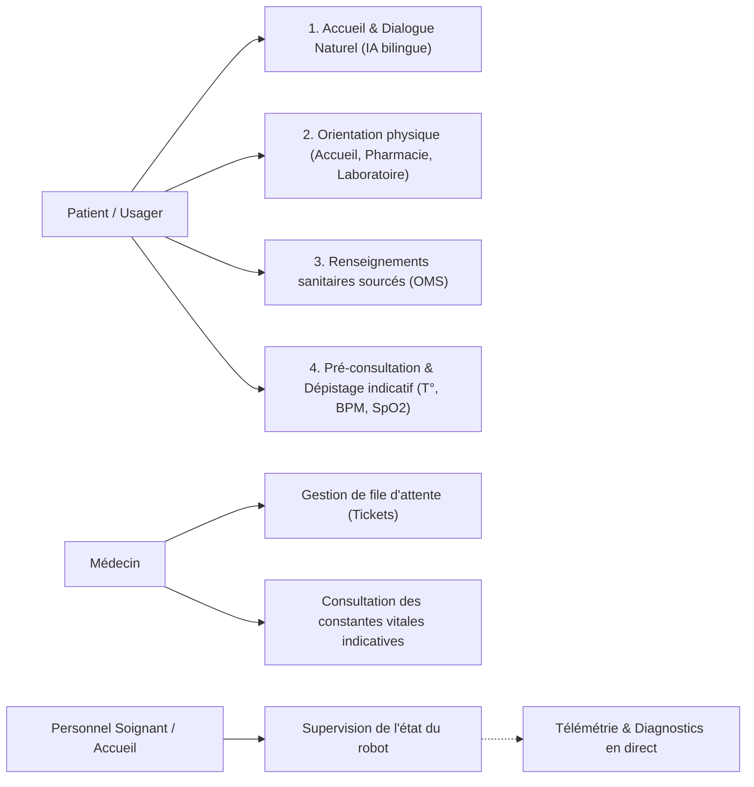
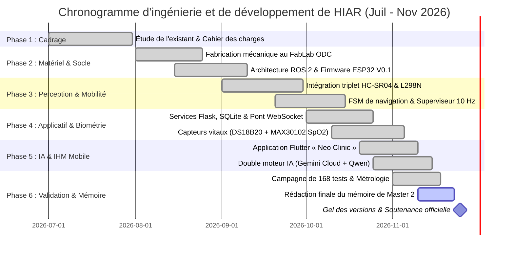

# PARTIE I. PRÉSENTATIONS

---

# Chapitre 1. Présentation de l'École Nationale d'Informatique

L'École Nationale d'Informatique (ENI) est l'institution universitaire pionnière et de référence à Madagascar dans l'enseignement supérieur et la recherche en sciences informatiques, technologies de l'information et sciences du numérique. Ce chapitre présente son cadre statutaire, son historique, son organisation administrative et pédagogique, son offre de formation pluridisciplinaire ainsi que son ancrage dans le tissu socio-économique national et international.

---

## 1.1. Informations générales et historique

### 1.1.1. Statut juridique et coordonnées
L'École Nationale d'Informatique, désignée par le sigle **ENI**, est un Établissement Public d'Enseignement Supérieur à caractère professionnel et scientifique, rattaché organiquement, administrativement et académiquement à l'**Université de Fianarantsoa**.

- **Siège administratif et campus universitaire :** Campus universitaire de Tanambao-Antaninarenina, BP 1487, Fianarantsoa (Code postal 301), Madagascar.
- **Courriel officiel :** eni@eni.mg
- **Site web institutionnel :** [www.eni.mg](https://www.eni.mg)

### 1.1.2. Missions fondamentales et historique de l'institution
L'ENI a été instituée par le **décret ministériel n° 83-185 du 24 mai 1983**. Sa création répondait à un impératif stratégique de souveraineté nationale : former des cadres supérieurs, des ingénieurs et des techniciens informaticiens de haut niveau capables de concevoir, déployer, administrer et sécuriser les systèmes informatiques des administrations publiques, des banques et des entreprises industrielles malgaches.

Les missions statutaires de l'ENI s'articulent autour de trois piliers indissociables :
1. **L'acquisition des savoirs fondamentaux :** Dispenser un enseignement scientifique de haut niveau en algorithmique, mathématiques appliquées, architecture des ordinateurs et modélisation de données ;
2. **La professionnalisation et l'employabilité :** Aligner continuellement les curricula de formation sur l'état de l'art technologique mondial et sur les besoins concrets du marché du travail (génie logiciel, réseaux, objets connectés, cybersécurité, intelligence artificielle) ;
3. **La recherche scientifique et l'innovation :** Former des chercheurs et doctorants capables de produire des contributions scientifiques originales dans les domaines des Technologies de l'Information et de la Communication (TIC).

Depuis sa fondation, l'école a connu plusieurs jalons structurels déterminants :
- **1983 :** Ouverture de la filière historique d'Analystes Programmeurs (Bac+3), gelée en 1996 au profit de formations plus avancées.
- **1986 :** Création du cycle d'Ingéniorat en Informatique (Bac+5).
- **2003 – 2004 :** Lancement du troisième cycle universitaire (DESS puis Master Recherche) en partenariat de coopération académique avec l'Université Paul Sabatier de Toulouse (France).
- **2007 – 2008 :** Basculement pionnier vers le système d'harmonisation universitaire **LMD** (Licence – Master – Doctorat) avec les parcours *Génie Logiciel et Base de Données* (GLBD) et *Administration des Systèmes et Réseaux* (ASR).
- **2010 :** Déploiement d'une infrastructure d'enseignement hybride (associant télé-enseignement par visioconférence et cours en présentiel) permettant d'accroître les capacités d'accueil de l'établissement.
- **2023 :** Création de la prestigieuse mention **Intelligence Artificielle (IA)**, intégrant deux parcours de spécialisation d'avant-garde : *Gouvernance et Ingénierie de Données* (GID) et **Objets Connectés et Cybersécurité (OCC)**, parcours au sein duquel s'inscrit le présent projet de fin d'études.
- **2024 – 2026 :** Ouverture de la mention *Expertise Digitale* et restructuration moderne des parcours de la mention Informatique en ILSI, ISRI et ISII.

---

## 1.2. Organisation et domaines de spécialisation

### 1.2.1. Organigramme institutionnel
L'administration de l'ENI repose sur une gouvernance collégiale et participative fixée par les dispositions du décret n° 83-185 :
- Le **Conseil d'École** : Organe suprême d'orientation stratégique, regroupant des représentants des ministères de tutelle, des autorités universitaires, des enseignants-chercheurs et du secteur professionnel privé.
- La **Direction de l'École** : Dirigée par un Directeur nommé par décret pris en Conseil des Ministres, assisté d'un secrétariat principal, des services de scolarité, de comptabilité et d'intendance.
- Le **Collège des Enseignants** : Instance réunissant le corps professoral permanent pour délibérer sur l'organisation des examens, les modalités pédagogiques et les progressions des étudiants.
- Le **Conseil Scientifique** : Organe consultatif garant de la pertinence des programmes académiques, de la politique de recherche et des conventions doctorales.

*Figure 1 : Organigramme institutionnel et structure pédagogique de l'ENI (Source : ENI)*

### 1.2.2. Domaines de spécialisation et corps enseignant
L'encadrement des étudiants est assuré par un corps professoral hautement qualifié composé de seize enseignants permanents (1 Professeur Titulaire, 2 Professeurs, 9 Maîtres de Conférences et 4 Assistants d'Enseignement Supérieur et de Recherche), appuyé par des vacataires professionnels spécialisés.

*Tableau 1 : Responsables de l'équipe de direction pédagogique de l'ENI*

| Fonction institutionnelle | Nom, Prénoms et Titre académique |
| :--- | :--- |
| **Directeur de l'École** | **M. MAHATODY Thomas**, Professeur Titulaire |
| **Responsable de la Mention « Informatique »** | **M. RALAIVAO Jean Christian**, Maître de Conférences |
| **Responsable de la Mention « Intelligence Artificielle »** | **M. DIMBISOA Germain William**, Maître de Conférences |
| **Responsable du Parcours ILSI** | **Mme RATIANANTITRA Volatiana Marielle**, Maître de Conférences |
| **Responsable du Parcours ISRI** | **M. RAZAFINDRAIBE Marolahy Alix**, Assistant d'Enseignement Supérieur et de Recherche |
| **Responsable du Parcours ISII** | **M. RAZAFINDRAMONJA Clément Aubert**, Assistant d'Enseignement Supérieur et de Recherche |
| **Responsable du Parcours GID** | **Mme RAKOTOASIMBAHOAKA Antsa Cyprienna**, Maître de Conférences |
| **Responsable du Parcours OCC** | **M. GILANTE Gesazafy**, Assistant d'Enseignement Supérieur et de Recherche |

---

## 1.3. Offre de formation

L'ENI applique les normes pédagogiques internationales du système LMD, articulées autour d'enseignements théoriques magistraux, de travaux dirigés (TD), de travaux pratiques en laboratoire (TP) et de projets de recherche appliquée en entreprise.

*Tableau 2 : Récapitulatif des Mentions et Parcours habilités à l'ENI*

| Mention | Parcours de spécialisation | Objectifs de formation |
| :--- | :--- | :--- |
| **Informatique** | • **ILSI** : Ingénierie Logicielle et Systèmes d'Information • **ISRI** : Ingénierie des Systèmes et Réseaux Informatiques • **ISII** : Ingénierie des Systèmes d'Information Intégrés | Conception de solutions logicielles complexes, administration avancée des infrastructures d'entreprises, virtualisation et cloud computing. |
| **Intelligence Artificielle (IA)** | • **GID** : Gouvernance et Ingénierie de Données • **OCC** : Objets Connectés et Cybersécurité | Data science, machine learning, ingénierie des systèmes cyber-physiques (IoT), robotique autonome, cryptographie appliquée et sécurisation des réseaux. |
| **Expertise Digitale** | • **MDi** : Métiers du Digital • **ASI** : Audit des Systèmes d'Information | Pilotage de la transformation numérique, marketing digital, gouvernance IT et audit de conformité des systèmes informatiques. |

*Tableau 3 : Modalités pédagogiques des formations à l'ENI*

| Composante de formation | Activités pédagogiques associées |
| :--- | :--- |
| **Formation Théorique** | Cours magistraux, conférences scientifiques, travaux dirigés, séminaires thématiques, veille technologique. |
| **Formation Pratique & Professionnelle** | Séances de travaux pratiques sur bancs d'essai (IoT, serveurs, routeurs), projets tutorés annuels, hackathons, stages professionnels d'immersion et mémoires de fin d'études. |

*Tableau 4 : Conditions d'accès et diplômes délivrés selon le cycle LMD*

| Cycle universitaire | Modalités d'admission | Conditions de diplôme d'accès | Durée légale | Diplôme décerné |
| :--- | :--- | :--- | :--- | :--- |
| **Licence Professionnelle** | Concours national d'entrée | Baccalauréat scientifique (Séries C, D ou Technique) | 3 ans (6 semestres, 180 crédits) | Diplôme de Licence Professionnelle en Informatique |
| **Master Professionnel / Recherche** | Concours pour la mention IA / Admission sur dossier | Titulaire d'une Licence Professionnelle en Informatique | 2 ans (4 semestres, 120 crédits) | Diplôme de Master en Informatique (Mention IA) |
| **Doctorat (ED-STII)** | Sélection sur projet de thèse | Titulaire d'un Master de Recherche | 3 à 5 ans | Diplôme de Docteur de l'Université de Fianarantsoa |

*Figure 2 : Architecture des études universitaires selon le système LMD à l'ENI*

---

## 1.4. Relations avec les organismes externes et débouchés

Forte de plus de quatre décennies d'expertise, l'ENI entretient des partenariats industriels actifs avec plus de 400 entreprises, institutions bancaires et opérateurs de télécommunications nationaux et internationaux (notamment **Orange Madagascar**, Telma, Airtel, Axian, BNI Madagascar, Société Générale, Bank of Africa, JIRAMA, ainsi que l'Agence Universitaire de la Francophonie - AUF).

*Tableau 5 : Débouchés professionnels représentatifs par mention*

| Mention / Parcours | Débouchés professionnels et métiers cibles |
| :--- | :--- |
| **Informatique (ILSI, ISRI, ISII)** | Ingénieur logiciel full-stack, architecte de systèmes d'information, ingénieur DevOps, administrateur systèmes et réseaux, architecte cloud, chef de projet technique. |
| **Intelligence Artificielle (GID, OCC)** | **Ingénieur et architecte IoT**, **ingénieur en robotique et systèmes embarqués**, data scientist, ingénieur en apprentissage automatique (Machine Learning Engineer), **analyste en cybersécurité**, auditeur de sécurité IoT, consultant en IA appliquée. |
| **Expertise Digitale (MDi, ASI)** | Auditeur des systèmes d'information, chef de projet digital, consultant en transformation numérique, responsable de la conformité des données (Data Protection Officer). |

---

# Chapitre 2. Présentation de l'établissement d'accueil

Le stage de recherche appliquée et d'ingénierie concourant à ce mémoire de fin d'études Master 2 s'est déroulé au sein de l'**Orange Digital Center (ODC)**, initiative stratégique d'innovation ouverte portée par l'opérateur de télécommunications **Orange Madagascar**. Ce chapitre présente la société marraine, le dispositif ODC et la contribution matérielle et technique de la structure d'accueil au projet HIAR.

---

## 2.1. Orange Madagascar

### 2.1.1. Historique, statut et identification
Marque mondiale de référence dans les télécommunications issue du Royaume-Uni en 1994 et intégrée au groupe France Télécom en 2000, Orange s'est implantée à Madagascar en juin 2003 par l'acquisition et le renommage de la société *Antaris*, pionnière du réseau mobile GSM dans la Grande Île depuis mars 1998.

*Tableau 6 : Fiche d'identification institutionnelle d'Orange Madagascar*

| Rubrique légale | Informations d'identification |
| :--- | :--- |
| **Dénomination sociale** | Orange Madagascar S.A. |
| **Forme juridique** | Société Anonyme (S.A.) avec Conseil d'Administration |
| **Siège social** | Immeuble Orange, Boulevard de Ranavalona III, Ankorondrano, Antananarivo, Madagascar |
| **Portail officiel** | [www.orange.mg](https://www.orange.mg) |
| **Domaines d'activité** | Opérateur de télécommunications mobiles (4G/5G), connectivité Internet très haut débit (fibre optique, liaisons spécialisées), services financiers mobiles (Orange Money), solutions de transformation numérique pour entreprises. |

### 2.1.2. Organisation interne et valeurs d'entreprise
Orange Madagascar déploie ses activités à travers plusieurs directions opérationnelles de premier plan, parmi lesquelles la Direction Technique et Informatique (DTI), chargée de l'ingénierie réseau, des infrastructures d'interconnexion et de la sécurité des données. L'entreprise fonde son engagement sociétal et d'innovation sur cinq valeurs cardinales : l'audace, le dynamisme, la simplicité, la proximité et la transparence.

---

## 2.2. Orange Digital Center (ODC)

### 2.2.1. Programme mondial et missions en Afrique
L'**Orange Digital Center** est un écosystème d'innovation numérique créé par le groupe Orange pour stimuler l'employabilité des jeunes, soutenir l'entrepreneuriat technologique et accompagner l'émergence de solutions d'intérêt sociétal dans la région Afrique et Moyen-Orient (MEA). Chaque ODC rassemble en un même lieu gratuit et ouvert à tous quatre entités synergiques :
1. **L'École du Code :** Centre de formation pratique aux technologies émergentes (développement mobile, web, IA, cloud) ;
2. **Le FabLab Solidaire :** Atelier de fabrication numérique équipé d'outils de prototypage rapide (imprimantes 3D, découpeuses laser, fraiseuses CNC, bancs de test électronique et cartes à microcontrôleurs) soutenu par la Fondation Orange ;
3. **Orange Fab :** Accélérateur de start-ups fournissant un mentorat managérial et des opportunités d'accès au marché ;
4. **Orange Ventures :** Fonds d'investissement corporate dédié au financement de solutions à fort impact.

Inauguré à Antananarivo sur une superficie de 800 m², l'ODC de Madagascar constitue le 9e centre du réseau en Afrique.

### 2.2.2. L'ODC Club de Fianarantsoa
Afin de décentraliser ses activités en province et de rapprocher les technologies de fabrication numérique des étudiants en informatique, Orange Madagascar a implanté un **ODC Club** au cœur du campus universitaire d'Andrainjato à Fianarantsoa, à proximité immédiate de l'ENI. Cet espace comprend une École du Code et un FabLab Solidaire permettant le prototypage physique de systèmes embarqués, de circuits imprimés et de robots communicants. C'est dans cet environnement expérimental privilégié que le robot HIAR a été conçu, monté et testé.

---

## 2.3. Contribution de la structure d'accueil au projet

L'ODC Madagascar a apporté un appui déterminant à la réussite de ce travail de recherche :
- **Mise à disposition des infrastructures et du matériel :** Accès illimité aux équipements du FabLab Solidaire de Fianarantsoa pour l'usinage du châssis mécanique en bois, le banc de câblage électronique, la programmation des cartes ESP32 et Raspberry Pi 4, et l'accès à une connexion réseau haut débit dédiée aux tests ;
- **Encadrement professionnel spécialisé :** Suivi technique continu assuré par **M. HERIMAMPIONONA Hasindrainy Florent**, Coordinateur de l'ODC Club Fianarantsoa et rapporteur professionnel de ce mémoire. Son expertise approfondie des architectures embarquées et de la gestion de projets technologiques a permis de guider l'auteure dans les arbitrages d'ingénierie critique (multiplexage des bus, dissociation des alimentations de puissance et de logique, isolation des communications).

---

# Chapitre 3. Description du projet HIAR

---

## 3.1. Formulation de la problématique

### Contexte hospitalier et limites de l'accueil traditionnel
Dans les établissements hospitaliers malgaches — à l'instar des Centres Hospitaliers Universitaires (CHU Tambohobe et Andrainjato à Fianarantsoa, CHU JRA et HJRB à Antananarivo) —, la gestion du flux des usagers à l'entrée constitue une source majeure de dysfonctionnements opérationnels :
- **Désorientation spatiale :** La multiplicité des bâtiments, des pavillons et des spécialités cliniques désoriente les patients, en particulier les primo-arrivants ruraux et les personnes âgées.
- **Signalétique défaillante :** Les plans muraux et panneaux directionnels existants sont souvent dégradés, statiques, rédigés dans un jargon médical abscons et inadaptés aux populations illettrées ou parlant exclusivement le malgache vernaculaire.
- **Surcharge du personnel soignant :** En l'absence d'agents d'accueil dédiés, les infirmiers et aides-soignants sont constamment interrompus par des demandes d'orientation basiques (emplacement de la pharmacie, du laboratoire ou de la caisse), au détriment direct du soin aux malades.
- **Goulots d'étranglement lors de l'enregistrement :** L'évaluation préliminaire des signes vitaux (température, pouls) et la saisie administrative au guichet provoquent de longues files d'attente génératrices d'anxiété et de risques de transmission d'infections nosocomiales.

### L'impératif du « Low-Cost » et de la sécurité déterministe
Bien que la robotique médicale de service ait démontré son efficacité dans les cliniques occidentales, les solutions commerciales existantes reposent sur des capteurs LiDAR 3D, des caméras de profondeur stéréoscopiques et des processeurs industriels extrêmement onéreux, dont les coûts d'acquisition et de maintenance s'élèvent à plusieurs dizaines de milliers d'euros. Transposer ces technologies telles quelles dans le contexte hospitalier public de Madagascar est économiquement irréaliste.

Le défi fondamental consiste donc à concevoir un **robot assistant hospitalier à très faible coût (low-cost)**, assemblé à partir de composants électroniques grand public et de matériaux locaux, tout en fournissant des services d'assistance utiles, stables et sécurisés.

Toutefois, ce choix de conception impose des compromis physiques rigoureux : en l'absence de capteurs de positionnement absolu (encodeurs rotatifs de roue, centrale inertielle IMU de haute précision, LiDAR), le robot ne possède pas de modèle cartographique parfait de son environnement. Sa mobilité relève donc d'une **simulation d'accompagnement réactive et bornée dans le temps et dans l'espace**.

### Problématique générale de recherche
Dès lors, la problématique centrale de ce mémoire s'énonce comme suit :

> **« Comment concevoir et développer un robot assistant hospitalier autonome à faible coût, capable de fournir des services d'accueil et d'information sanitaire, d'orienter réactivement les usagers dans un espace intérieur contrôlé et de pré-enregistrer des données de santé indicatives, tout en garantissant une stricte étanchéité de sécurité entre la compréhension en langage naturel, la décision algorithmique et l'actionnement physique des moteurs ? »**

### Règle d'or architecturale du projet
Pour répondre de manière infaillible à ce défi sans jamais mettre en péril la sécurité physique des patients, le projet applique le principe directeur inviolable suivant :
$$\boxed{\textbf{L'IA comprend et suggère } \longrightarrow \textbf{ La Navigation décide } \longrightarrow \textbf{ Le Superviseur valide } \longrightarrow \textbf{ L'ESP32 exécute}}$$

Aucune couche logicielle supérieure (ni l'interface utilisateur, ni le moteur d'intelligence artificielle) ne possède un accès direct ou implicite aux commandes de puissance des moteurs.

### Hypothèses de recherche et objectifs associés
Trois hypothèses de conception directrices structurent l'ensemble des développements :

*Tableau 7 : Hypothèses de recherche et objectifs associés du projet*

| Hypothèse | Principe scientifique étudié | Objectif technique visé |
| :--- | :--- | :--- |
| **H1** | **Navigation réactive par capteurs acoustiques économiques :** Une télémétrie reposant sur un triplet séquentiel de modules ultrasoniques HC-SR04 permet de guider réactivement un robot et d'éviter les obstacles sans recourir à un LiDAR coûteux. | Détecter les obstacles frontaux et latéraux ($< 20\text{ cm}$) et exécuter une avance bornée d'orientation en milieu intérieur contrôlé. |
| **H2** | **Séparation stricte des responsabilités logicielles :** L'isolation formelle entre l'analyse sémantique, la machine à états de navigation, la supervision par watchdog et l'exécution matérielle garantit la sûreté de fonctionnement. | Empêcher toute commande motrice erronée, non validée ou en conflit avec un obstacle physique. |
| **H3** | **Architecture modulaire distribuée et évolutive :** L'interconnexion par middleware robotique (ROS 2 Humble) et WebSockets permet d'intégrer progressivement des services hétérogènes (mobilité, biométrie, IA hybride, mobile). | Faciliter le développement, les tests unitaires isolés et le déploiement sur cibles embarquées limitées (Raspberry Pi 4 / ESP32). |

---

## 3.2. Objectifs du projet et besoins des utilisateurs

### Les besoins des usagers hospitaliers
Le système HIAR répond aux besoins de trois catégories d'utilisateurs au sein de l'hôpital :

*Figure 3 : Cartographie des services offerts par HIAR selon les profils d'utilisateurs*

1. **Besoin d'orientation et de guidage spatial :** L'usager choisit une destination parmi les services prioritaires prédéfinis (**Pharmacie**, **Laboratoire d'analyses**, **Accueil / Réception**). Le robot valide la faisabilité et guide l'usager par une avance contrôlée avec évitement d'obstacle.
2. **Besoin d'information sanitaire préventive :** L'usager consulte six fiches d'éducation à la santé rédigées à partir de sources scientifiques institutionnelles (Organisation Mondiale de la Santé - OMS, Ministère de la Santé publique malgache) : VIH/SIDA, Paludisme, Diabète, Hypertension artérielle, Tuberculose et Santé menstruelle.
3. **Besoin d'inscription et de relevé biométrique indicatif :** L'usager réserve une consultation auprès d'un médecin disponible, saisit son numéro de téléphone normalisé (+261) et se soumet, de façon guidée et interactive, au relevé de ses constantes vitales : température cutanée (DS18B20), fréquence cardiaque et saturation en oxygène $\text{SpO}_2$ (MAX30102). Un ticket de file d'attente (ex: `A-AM-1`) lui est attribué, sauvegardé dans une base relationnelle locale SQLite et consultable par le praticien.

### Déclinaison des 12 objectifs du projet (O1 à O12)
Le cahier des charges opérationnel décline ces exigences en douze objectifs mesurables, hiérarchisés par niveau de criticité :

*Tableau 8 : Objectifs techniques du projet HIAR par niveau de priorité*

| Niveau | Identifiant | Désignation de l'objectif | Description synthétique |
| :--- | :--- | :--- | :--- |
| **N1** *(Non négociable)* | **O1** | Interface mobile tactile ergonomique | Développer une interface tactile intuitive (Flutter / Web responsive) accessible directement au chevet du robot. |
| **N1** *(Non négociable)* | **O2** | Transmission et validation ROS 2 | Valider rigoureusement toute demande applicative via `/hmi/request` avant republication vers le middleware. |
| **N1** *(Non négociable)* | **O3** | Navigation réactive sûre | Implémenter un comportement d'évitement d'obstacles fiable fondé sur la télémétrie acoustique. |
| **N1** *(Non négociable)* | **O4** | Démonstration d'orientation bornée | Exécuter une mission de déplacement balisée dans le temps (timeout) et l'espace sans intervention humaine. |
| **N1** *(Non négociable)* | **O5** | Déploiement embarqué autonome | Exécuter l'ensemble des nœuds ROS 2 et serveurs applicatifs sur la monocarte Raspberry Pi 4. |
| **N1** *(Non négociable)* | **O6** | Sécurité cinématique déterministe | Verrouiller matériellement et logiciellement l'avance (`FORWARD`) en présence d'un obstacle frontal $< 20\text{ cm}$. |
| **N2** *(Important)* | **O7** | Gestion des rendez-vous en base SQLite | Assurer la persistance cohérente des inscriptions, la gestion des sessions médecins et l'unicité des tickets journaliers. |
| **N2** *(Important)* | **O8** | Fiches sanitaires institutionnelles | Diffuser des informations de santé vérifiées assorties d'une mention légale de non-substitution au diagnostic. |
| **N2** *(Important)* | **O9** | Cybersécurité et cloisonnement réseau | Déployer un point d'accès Wi-Fi dédié (WPA2), des jetons d'authentification à temps constant et la minimisation des données. |
| **N3** *(Conditionnel)* | **O10** | Chaîne biométrique des signes vitaux | Intégrer les capteurs DS18B20 et MAX30102 pour relever température, BPM et $\text{SpO}_2$ sous réserve de contact stable. |
| **P2** *(Optionnel)* | **O11** | Compréhension du langage naturel par IA | Déployer un moteur d'IA hybride (Gemini 2.5 Flash + Fallback local Qwen 0.5B) pour classifier les intentions orales et textuelles. |
| **Transversal** | **O12** | Qualification expérimentale et métrologie | Produire un corpus d'essais quantitatifs (latences, distances d'arrêt, répétabilité, 168 tests unitaires) consigné dans le mémoire. |

---

## 3.3. Moyens nécessaires à la réalisation du projet

### Moyens humains
- **Auteure et conceptrice :** Mlle RAZAKAHARISOA Barovaosolo Cecilia (Étudiante en Master 2 IA / OCC).
- **Encadreur pédagogique :** Pr MAHATODY Thomas (Professeur Titulaire, Directeur de l'ENI).
- **Encadreur professionnel :** M. HERIMAMPIONONA Hasindrainy Florent (Coordinateur ODC Club Fianarantsoa).

### Moyens matériels

*Tableau 9 : Inventaire des composants matériels utilisés pour le prototype HIAR*

| Sous-système | Composant / Modèle | Rôle fonctionnel dans le robot | Spécifications d'intégration |
| :--- | :--- | :--- | :--- |
| **Calcul principal** | Raspberry Pi 4 Model B (4 Go RAM) | Hôte de ROS 2 Humble, des passerelles WebSockets, de l'API Flask, de SQLite et du serveur d'inférence Qwen. | OS Ubuntu 22.04 LTS (64 bits), Wi-Fi HostAP (`HIAR-DEMO`), alimentation USB-C 5V/3A. |
| **Contrôle temps réel** | ESP32-WROOM-32 (NodeMCU-32S) | Gestion des entrées-sorties matérielles : PWM moteurs, lecture multiplexée des 3 ultrasons, bus 1-Wire et I2C. | Fréquence 240 MHz, Dual Core, liaison UART USB vers Raspberry Pi à 115200 bauds. |
| **Actionneurs** | Double pont en H L298N + 2 motoréducteurs DC (1:48) | Motorisation différentielle du robot (roues motrices gauche et droite) et roulette folle (caster wheel). | Commande en modulation PWM (20 kHz, 8 bits), alimentation séparée par pack d'accumulateurs Li-ion 18650. |
| **Perception spatiale** | 3 modules ultrasoniques HC-SR04 | Mesure de distance métrique et détection d'obstacles : Avant (GPIO 13/34), Gauche (GPIO 2/4), Droite (GPIO 5/16). | Plage 2 – 400 cm, multiplexage séquentiel à 35 ms, diviseurs de tension résistifs sur échos (5V $\to$ 3,3V). |
| **Biométrie thermique** | Sonde Dallas DS18B20 étanche | Prise de la température cutanée par contact digital direct. | Protocole 1-Wire (GPIO 23), résistance de tirage (*pull-up*) de 4,7 kΩ, résolution 12 bits (0,0625 °C). |
| **Biométrie optique** | Capteur oxymétrique MAX30102 | Mesure du pouls cardiaque (BPM) et de la saturation en oxygène ($\text{SpO}_2$) par photopléthysmographie. | Bus I2C (GPIO 21 SDA / GPIO 22 SCL), alimentation 3,3 V, diodes Rouge (660 nm) et Infrarouge (880 nm). |
| **IHM Utilisateur** | Smartphone tactile Android / Tablette | Écran de bord fixé au sommet du mât du robot pour l'interaction visuelle et tactile avec les usagers. | Connecté au point d'accès Wi-Fi local du robot, application Flutter native / navigateur Chrome plein écran. |
| **Châssis mécanique** | Châssis vertical en bois avec mât | Structure porteuse hébergeant les batteries, le panier électronique et le support ergonomique pour le smartphone. | Conçu et usiné au FabLab Solidaire de l'ODC Fianarantsoa (hauteur totale : 1,10 m). |

### Moyens logiciels
- **Middleware robotique :** ROS 2 Humble Hawksbill sous Ubuntu 22.04.5 LTS (architecture en nœuds modulaires communicant via le protocole DDS / RTPS).
- **Firmware embarqué :** C++ compilé sous Arduino IDE / PlatformIO avec gestion des interruptions matérielles et timers non bloquants.
- **Applications utilisateur :** 
  - Application mobile native développée sous **Flutter** (Dart) avec gestion d'état réactive et WebSockets contractuels ;
  - Serveur Web applicatif développé sous **Flask** (Python 3.10) avec base de données relationnelle **SQLite 3** (transactions ACID `BEGIN IMMEDIATE`).
- **Intelligence Artificielle :** Google Gemini Flash API (`gemini-2.5-flash`), Ollama avec modèle quantifié `qwen2.5:0.5b`, bibliothèques scikit-learn et SpeechRecognition.
- **Outils d'assurance qualité :** Framework de test unitaire automatisé **pytest** (168 tests), suites de tests widget Flutter, Git/GitHub pour le versionnement logiciel.

---

## 3.4. Résultats attendus et matrice de conformité

*Tableau 10 : Matrice des résultats attendus et des preuves de validation expérimentales*

| Objectif | Intitulé synthétique | Preuve de qualification exigée | Statut validé sur prototype |
| :--- | :--- | :--- | :--- |
| **O1** | IHM tactile interactive | Navigation fluide sans plantage sur l'ensemble des écrans (consultation, orientation, fiches sanitaires). | **Validé** (Flutter & Web) |
| **O2** | Validation des requêtes ROS 2 | Rejet systématique des trames malformées et republication conforme sur `/navigation/request`. | **Validé** (100 % de succès) |
| **O3** | Navigation réactive autonome | Détection des obstacles frontaux et latéraux et contournement autonome sans blocage. | **Validé** (Triplet HC-SR04) |
| **O4** | Mission d'orientation bornée | Parcours reproductible vers un service avec arrêt automatique en fin de trajectoire. | **Validé** (Taux de succès > 80 %) |
| **O5** | Déploiement centralisé | Démarrage propre de l'ensemble des nœuds par un seul fichier launch (`ros2 launch`). | **Validé** (5/5 nœuds actifs) |
| **O6** | Sécurité motrice déterministe | Refus absolu d'avance (`FORWARD`) si obstacle $< 20\text{ cm}$ ; exécution prioritaire de `STOP`. | **Validé** (Double garde-fou) |
| **O7** | Gestion des consultations SQLite | Attribution séquentielle de tickets sans collision, rejet immédiat des doublons téléphoniques. | **Validé** (Code 409 conforme) |
| **O8** | Fiches d'information certifiées | Affichage des 6 fiches thématiques avec citation formelle des sources OMS et clauses d'avertissement. | **Validé** (Conformité éditoriale) |
| **O9** | Cybersécurité et protection | Accès aux consoles soignants protégé par jetons HTTP secrets comparés à temps constant. | **Validé** (HMAC timing-safe) |
| **O10** | Relevé des signes vitaux | Affichage temps réel de la température, du rythme cardiaque et de la $\text{SpO}_2$ avec exclusion mutuelle motrice. | **Validé** (T°, BPM, $\text{SpO}_2$) |
| **O11** | IA conversationnelle hybride | Classification et extraction d'entités avec basculement fluide de Gemini 2.5 Flash vers Qwen local. | **Validé** (Dual engine opérationnel) |
| **O12** | Métrologie et couverture logicielle | Compilation de 168 tests unitaires sans échec et relevé des latences de réponse système. | **Validé** (168/168 tests pytest) |

---

## 3.5. Chronogramme de réalisation des travaux

Les travaux de conception, de développement et d'expérimentation du robot HIAR se sont échelonnés sur une période de cinq mois, de juillet à novembre 2026, selon le calendrier prévisionnel et effectif illustré ci-dessous :

*Figure 4 : Chronogramme synoptique des phases d'ingénierie du projet HIAR*
