# PARTIE II. ANALYSE ET CONCEPTION

---

# Chapitre 4. Analyse préalable

Ce chapitre pose les fondations méthodologiques du projet HIAR à travers une étude critique des processus actuels d'orientation hospitalière, un inventaire précis des technologies disponibles au lancement des travaux et une formalisation de la démarche d'avant-projet ayant guidé nos choix d'ingénierie.

---

## 4.1. Analyse de l'existant

### 4.1.1. Organisation actuelle des flux et personnel impliqué
Dans la quasi-totalité des établissements de soins de santé publics à Madagascar, le parcours de l'usager repose sur une organisation humaine traditionnelle complétée par une signalétique matérielle statique :
- **L'accueil et l'enregistrement initial :** Assurés au niveau de guichets centraux par des agents d'accueil et des secrétaires administratifs. Ces agents reçoivent les usagers, vérifient sommairement leur carnet de santé, les orientent manuellement vers les services cliniques compétents et inscrivent les demandes de consultation sur des registres physiques en papier ou des feuilles de calcul locales hétérogènes.
- **La signalétique physique :** Constituée de panneaux muraux, de fléchages peints au sol et de plans d'ensemble affichés dans le hall. Ces supports sont invariablement statiques : ils ne tiennent compte ni des changements d'affectation temporaires des salles, ni de la barrière linguistique (usage fréquent du français technique inaccessible aux usagers ruraux unilingues malgachophones), ni du handicap visuel ou de l'analphabétisme.
- **La prise préliminaire des constantes vitales :** Déléguée aux infirmiers et aides-soignants postés à l'entrée des consultations. Cette étape implique la mesure de la température par thermomètre infrarouge frontal et du pouls au moyen d'oxymètres de pouls portatifs, suivie d'une retranscription manuscrite sur une fiche cartonnée.

*Tableau 11 : Acteurs humains et processus d'accueil actuels en milieu hospitalier*

| Rôle fonctionnel | Acteurs impliqués | Tâches assurées | Limites opérationnelles constatées |
| :--- | :--- | :--- | :--- |
| **Accueil & Orientation** | Hôtesses d'accueil, agents de sécurité | Renseignement verbal, orientation vers les pavillons, régulation physique des entrées. | Disponibilité limitée aux heures de pointe ; fatigue face aux sollicitations répétitives ; absence de guidage physique dans les couloirs. |
| **Enregistrement administratif** | Secrétaires d'admission | Inscription sur registre papier, délivrance de tickets manuels, encaissement des frais. | Files d'attente massives ; lenteur de saisie ; risques majeurs d'erreurs d'orthographe ou de perte de dossiers. |
| **Triage & Signes vitaux** | Infirmiers, aides-soignants | Relevé ponctuel de la température et du pouls, évaluation visuelle de la gravité. | Mobilisation chronophage d'un personnel soignant qualifié au détriment direct des actes cliniques d'urgence. |

Cette organisation génère trois défaillances systémiques :
1. **Une saturation sévère des guichets :** Plus de 65 % des questions posées aux agents d'accueil portent sur la localisation élémentaire de trois services récurrents : la pharmacie, le laboratoire d'analyses et la caisse d'admission.
2. **Une rupture de service en dehors des plages ouvrées :** Dès la fin de journée ou le week-end, l'absence de personnel d'accueil laisse les usagers désorientés face aux urgences.
3. **Une vulnérabilité sanitaire accrue :** L'accumulation prolongée d'usagers non filtrés dans des halls mal ventilés favorise la propagation des infections respiratoires et nosocomiales.

### 4.1.2. Inventaire des moyens matériels et logiciels au lancement du projet
Au démarrage de la phase de conception intégrée (15 octobre 2026), un ensemble de briques technologiques hétérogènes avaient été préalablement expérimentées de façon isolée au sein de l'ODC Club Fianarantsoa.

*Tableau 12 : Inventaire initial des briques matérielles et logicielles disponibles*

| Brique technologique | État initial de validation | Limites et points de blocage constatés |
| :--- | :--- | :--- |
| **Châssis et motricité** | Châssis vertical en bois avec 2 moteurs DC pilotés par pont en H L298N. | Échauffement thermique prononcé du régulateur du L298N ; dérive cinématique non compensée ; arrêt d'urgence uniquement temporel (timeout 2 s). |
| **Contrôle embarqué (Firmware)** | ESP32-WROOM-32 exécutant des ordres moteurs simples (FORWARD, STOP) et lisant des capteurs basiques. | Mesures télémétriques instables ; conflits matériels entre les timers d'échos ultrasons et la boucle de contrôle moteur. |
| **Perception des obstacles** | 1 module HC-SR04 frontal et 2 barrières infrarouges (IR) analogiques LM393. | Les capteurs IR présentaient une sensibilité excessive à la luminosité ambiante et ne mesuraient aucune distance métrique ; le capteur frontal était sujet à des échos parasites. |
| **Chaîne des signes vitaux** | Sonde Dallas DS18B20 (1-Wire) et module optique MAX30102 (I2C) testés sur maquette séparée. | Aucune intégration sur le firmware principal ; blocage mutuel entre la conversion lente du DS18B20 (750 ms) et l'asservissement des moteurs. |
| **Middleware robotique** | Nœuds ROS 2 de base développés sous PC/WSL2 (`esp32_interface`, `obstacle_detector`). | Absence d'architecture de supervision robuste ; pas de coordination formelle avec les requêtes venues de l'IHM. |
| **Interface usager (IHM)** | Serveur Flask Web basique avec fiches d'information et ébauche d'API REST. | Interface découplée du robot réel ; absence de télémétrie en direct ; aucun canal de dialogue interactif en temps réel (WebSocket inexistant). |
| **Environnement logiciel** | Système d'exploitation Ubuntu 22.04 LTS sous WSL2 et dépôt Git initial. | Déploiement non finalisé sur la cible physique monocarte Raspberry Pi 4. |

---

## 4.2. Critique de l'existant

### 4.2.1. Analyse comparative des approches d'orientation
L'évaluation critique des modalités d'orientation hospitalière courantes met en exergue des compromis marqués entre coût financier, flexibilité et niveau d'assistance offert à l'usager :

*Tableau 13 : Analyse comparative des solutions courantes d'accueil et d'orientation*

| Solution étudiée | Avantages majeurs | Inconvénients et freins rédhibitoires |
| :--- | :--- | :--- |
| **Personnel d'accueil dédié** | Empathie naturelle, adaptabilité immédiate aux cas d'urgence, communication orale intuitive. | Coût salarial récurrent très lourd pour les hôpitaux publics ; disponibilité discontinue (absentéisme, grèves, nuits) ; saturation face aux demandes répétitives. |
| **Signalétique murale et marquage** | Coût d'installation quasi nul ; disponibilité 24h/24 sans consommation énergétique. | Statique et rigide ; incapable d'interagir ; inefficace pour les usagers analphabètes ou malvoyants ; encombrement visuel des couloirs. |
| **Borne interactive tactile fixe** | Autonomie de consultation ; intégration aux systèmes d'information hospitaliers (SIH). | Dispositif immobile ne guidant pas physiquement le patient ; coût unitaire élevé ; dégradation mécanique fréquente des écrans fixes. |
| **Robot d'assistance industriel (LiDAR 3D)** | Navigation autonome complexe (SLAM) ; cartographie dynamique multi-étages ; autonomie complète. | Coût prohibitif (> 20 000 à 50 000 €) totalement hors de portée des hôpitaux du Sud ; maintenance hautement spécialisée ; dépendance à des pièces d'importation. |

### 4.2.2. Bilan du socle initial et feuille de route d'amélioration
L'inventaire du prototype de départ a révélé un potentiel architectural certain mais bridé par quatre faiblesses critiques :
- **Instabilité de la détection optique latérale :** Les barrières infrarouges LM393 confondaient reflets au sol et obstacles réels, empêchant tout contournement fiable ;
- **Absence de télémétrie biométrique complète :** Le capteur MAX30102 n'exploitait que le signal infrarouge pour le pouls, laissant la saturation en oxygène ($\text{SpO}_2$) inopérante ;
- **Monolithisme de l'interface :** L'interface Web sur navigateur mobile souffrait de latences de rechargement HTTP, inadaptées à une interaction fluide au chevet du robot ;
- **Interprétation linguistique rudimentaire :** Le modèle linéaire TF-IDF initial échouait à saisir les nuances des requêtes formulées en langage naturel oral.

Cette analyse critique justifie le choix d'un **système robotique intermédiaire** : infiniment plus abordable qu'un robot industriel à LiDAR, plus interactif et dynamique qu'une borne fixe, et dont la sécurité matérielle est garantie par une séparation stricte des responsabilités.

---

## 4.3. Conception avant-projet

### 4.3.1. Arbitrages architecturaux fondamentaux
Chaque choix structurel du projet HIAR est le résultat d'une confrontation méthodique entre plusieurs alternatives techniques, guidée par les contraintes d'autonomie financière, de robustesse opérationnelle et de maintenabilité locale.

*Tableau 14 : Matrice d'analyse des alternatives technologiques et choix d'ingénierie*

| Domaine d'ingénierie | Alternatives étudiées | Solution retenue pour HIAR | Justification technique et scientifique |
| :--- | :--- | :--- | :--- |
| **Navigation & Localisation** | • LiDAR 2D/3D + SLAM + Nav2<br>• Navigation réactive par capteurs économiques | **Navigation réactive par triplet de capteurs ultrasoniques HC-SR04** | Élimination du surcoût d'un capteur LiDAR ($> 200$ €) ; robustesse acoustique face aux parois vitrées ; compatibilité avec la puissance de calcul modeste d'un Raspberry Pi 4. |
| **Capteurs latéraux d'évitement** | • Barrières infrarouges analogiques LM393<br>• Capteurs ultrasoniques HC-SR04 latéraux | **2 modules HC-SR04 additionnels (Gauche et Droite)** | Remplacement des capteurs IR instables ; acquisition de distances métriques homogènes sur 360° avant ; étalonnage logiciel d'esquive déterministe. |
| **Interface Homme-Machine (IHM)** | • Écran tactile fixe dédié sur port HDMI<br>• Application mobile tactile native (Flutter) | **Application native Flutter connectée en WebSockets** | Conception ergonomique réactive « Neo Clinic », animations didactiques vidéo (MP4), support du dialogue vocal bidirectionnel (STT/TTS) sans surcharge matérielle. |
| **Contrôle embarqué des capteurs** | • Architecture multi-ESP32 répartie<br>• ESP32 unique centralisé | **ESP32-WROOM-32 unique avec exclusion mutuelle logicielle** | Réduction de l'encombrement et du câblage ; verrouillage matériel empêchant tout déplacement pendant l'acquisition des constantes vitales. |
| **Moteur d'Intelligence Artificielle** | • Modèle TF-IDF statistique seul<br>• Cloud LLM exclusif<br>• Architecture hybride Dual-Engine (Cloud + Edge) | **Double moteur IA : Google Gemini 2.5 Flash en priorité + Fallback local Qwen 2.5 0.5B** | Compréhension sémantique contextuelle de haute volée avec Gemini via Internet, avec garantie de continuité de service absolue hors-ligne grâce à Qwen local sous Ollama. |
| **Infrastructure réseau** | • Dépendance au réseau Wi-Fi public de l'hôpital<br>• Point d'accès local privé émis par le robot | **Point d'accès Wi-Fi privé autonome (`HIAR-DEMO`) sous WPA2** | Isolation totale du trafic robotique vis-à-vis des perturbations et pannes du réseau hospitalier général. |

### 4.3.2. Méthode de conception et outillage logiciel
La méthodologie d'ingénierie appliquée repose sur quatre principes directeurs :
1. **Conception étanche en couches (Architecture Cyber-Physique) :** Séparation hermétique entre la perception, la communication, le traitement décisionnel et l'actionnement mécanique ;
2. **Développement incrémental orienté composants :** Découpage du projet en modules autonomes testés individuellement avant intégration dans le graphe ROS 2 ;
3. **Principe de validation par la preuve formelle :** Une fonction n'est considérée comme achevée que si elle satisfait à une preuve vérifiable (test unitaire automatisé, capture de trame, essai physique reproductible) ;
4. **Déontologie médicale et confidentialité « Privacy by Design » :** Minimisation drastique des données collectées et interdiction formelle de diffuser à voix haute les résultats d'analyses physiologiques.

*Tableau 15 : Synthèse des outils logiciels retenus et justifications*

| Outil / Framework | Rôle fonctionnel dans HIAR | Justification du choix |
| :--- | :--- | :--- |
| **ROS 2 Humble** | Middleware de communication inter-processus | Standard industriel pour la robotique, découplage modulaire par publication/abonnement (DDS/RTPS). |
| **Python 3.10** | Développement des nœuds ROS 2, serveurs et IA | Écosystème riche pour l'embarqué, interfaçage aisé avec les bibliothèques d'IA, syntaxe claire. |
| **Flutter / Dart** | Développement de l'IHM mobile interactive | Framework multiplateforme haute performance, rendu graphique 60 fps, intégration native WebSockets et synthèse vocale. |
| **Flask (Python)** | Serveur d'administration Web médicale | Serveur micro-framework ultra-léger pour les tableaux de bord sécurisés des soignants et médecins. |
| **SQLite 3** | Persistance locale des données de consultation | Moteur SQL embarqué sans serveur, support transactionnel ACID (`BEGIN IMMEDIATE`), zéro maintenance. |
| **Google Gemini API** | Moteur LLM principal (Cloud) | Raisonnement sémantique exceptionnel, prise en compte de prompts complexes avec cartographie hospitalière, latence faible. |
| **Ollama / Qwen 2.5** | Moteur LLM de repli (*Fallback Edge*) | Modèle open-source ultra-compact (0.5 milliard de paramètres), inférence locale sur processeur ARM sans connexion Internet. |
| **pytest** | Framework d'automatisation des tests | Exécution systématique de 168 tests unitaires garantissant la non-régression logicielle. |

---

# Chapitre 5. Modèle et Architecture de l'IoT

---

## 5.1. Cadre conceptuel et fondements du modèle IoT

### 5.1.1. Définition et principes fondamentaux de l'Internet des Objets
Selon la recommandation internationale **UIT-T Y.4000/Y.2060** de l'Union Internationale des Télécommunications (UIT), l'Internet des Objets (IoT) est défini comme une *« infrastructure mondiale pour la société de l'information, qui permet de disposer de services évolués en interconnectant des objets (physiques ou virtuels) grâce aux technologies de l'information et de la communication interopérables existantes ou en évolution »*.

Dans le paradigme des systèmes cyber-physiques hospitaliers, l'architecture IoT ne se contente pas de relier des capteurs passifs à un serveur distant : elle crée une boucle fermée d'interaction où des grandeurs physiques (distances d'obstacles, température cutanée, ondes de pouls sanguin) sont captées, numérisées, agrégées sous forme d'informations structurées, traitées par des modèles décisionnels et d'intelligence artificielle, puis traduites en actions physiques tangibles (déplacement cinématique des moteurs, guidage vocal, affichage d'un ticket de consultation).

### 5.1.2. Modèle architectural à 4 couches retenu pour HIAR
Pour structurer rigoureusement le système HIAR, nous adoptons une architecture fonctionnelle en **quatre couches hiérarchisées**, garantissant une modularité absolue et une maintenance aisée :

```mermaid
graph TD
    subgraph COUCHE 4 : APPLICATION & INTERFACES HOMME-MACHINE
        APP_FLUTTER["Application Mobile Tactile Flutter (Neo Clinic)"]
        WEB_PORTAL["Portail Web Médical Flask (Personnel & Médecins)"]
        TTS_STT["Synthèse Vocale (TTS) & Reconnaissance (STT)"]
    end

    subgraph COUCHE 3 : TRAITEMENT INTELLIGENT & DÉCISION ROBOTIQUE
        ROS_GRAPH["Graphe de Nœuds ROS 2 Humble (esp32_interface, navigation_decision, robot_supervisor)"]
        DUAL_AI["Moteur IA Hybride : Gemini 2.5 Flash (Cloud) + Qwen 2.5 0.5B (Edge)"]
        DB_SQLITE["Base de Données Relationnelle Locale SQLite (Tickets & Sessions)"]
    end

    subgraph COUCHE 2 : COMMUNICATION & TRANSPORT DE DONNÉES
        NET_WIFI["Réseau Wi-Fi Dédié Sécurisé WPA2 (HostAP HIAR-DEMO)"]
        PROTO_WS["WebSockets Bidirectionnels Temps Réel (Port 8765)"]
        UART_SERIAL["Liaison Série Asynchrone UART (115200 bauds, USB /dev/ttyUSB0)"]
        DDS_RTPS["Middleware Data Distribution Service (DDS / RTPS de ROS 2)"]
    end

    subgraph COUCHE 1 : PERCEPTION CYBER-PHYSIQUE & ACTIONNEMENT
        ESP_CORE["Microcontrôleur ESP32-WROOM-32 (Horloge Temps Réel, Firmware C++)"]
        SENS_US["Triplet HC-SR04 (Avant: 13/34, Gauche: 2/4, Droite: 5/16)"]
        SENS_VITALS["Sonde Thermique DS18B20 (1-Wire 23) & Oxymètre MAX30102 (I2C 21/22)"]
        ACT_MOTORS["Pilote Double Pont en H L298N & Moteurs DC à Réducteur"]
    end

    COUCHE 4 <==>|Wi-Fi / WebSockets & HTTP| COUCHE 3
    COUCHE 3 <==>|DDS Interne & UART Série| COUCHE 2
    COUCHE 2 <==>|Signaux Électriques & Bus Matériels| COUCHE 1
```
*Figure 12 : Modèle architectural global en couches du système cyber-physique HIAR*

### 5.1.3. Correspondance entre couches théoriques et équipements physiques
L'implémentation physique distribue judicieusement ces fonctions sur deux calculateurs complémentaires :
1. **Le Microcontrôleur ESP32 (Couche 1 & Couche 2 basse) :** Dédié à la gestion temporelle dure (*hard real-time*). Il assure le déclenchement périodique des impulsions de 10 µs des capteurs ultrasons, la lecture des bus OneWire et I2C, et la génération des signaux PWM commandant le pont en H.
2. **Le Nano-ordinateur Raspberry Pi 4 (Couche 2 haute, Couche 3 & Couche 4) :** Dédié au traitement logiciel haut niveau (*soft real-time*). Il exécute la distribution des messages ROS 2, la logique de navigation FSM, la supervision de sécurité, l'hébergement du serveur WebSocket asynchrone, les contraintes de base de données SQLite et l'exécution du modèle local d'intelligence artificielle Qwen.

---

## 5.2. Conception et rôle de la couche perception

La couche perception forme l'interface sensorielle et motrice entre le robot et son environnement hospitalier.

### 5.2.1. Le microcontrôleur embarqué : ESP32-WROOM-32
Le choix d'un composant unique pour la commande des moteurs et l'acquisition des constantes vitales permet de minimiser les coûts matériels et les complexités de synchronisation inter-cartes.

*Tableau 16 : Caractéristiques techniques et allocation des ressources de l'ESP32*

| Paramètre matériel | Spécification technique du composant | Usage spécifique dans l'architecture HIAR |
| :--- | :--- | :--- |
| **Processeur** | Xtensa Dual-Core 32-bit LX6 cadencé à 240 MHz | Cœur 0 : Traitement des interruptions de capteurs et calculs SpO2.<br>Cœur 1 : Boucle principale d'écoute série et asservissement moteur. |
| **Mémoire** | 520 Ko de SRAM interne, 4 Mo de mémoire Flash SPI | Stockage du firmware d'intégration, tampons FIFO et buffers circulaires. |
| **Interfaces matérielles** | GPIO, 3x UART, 2x I2C, 16 canaux PWM matériels | 6 sorties PWM pour L298N, 6 broches numériques pour ultrasons, 1 bus I2C, 1 bus 1-Wire. |
| **Gestion thermique** | Consommation optimisée, veille programmable | Fonctionnement continu stable sans dissipateur thermique actif. |

*Figure 5 : Carte de développement microcontrôleur ESP32-WROOM-32*

### 5.2.2. Perception de l'environnement : Le triplet ultrasonique HC-SR04
Contrairement à la version initiale qui associait un capteur frontal et des barrières infrarouges sensibles aux perturbations lumineuses, l'architecture définitive intègre une ceinture de **trois modules ultrasoniques HC-SR04** disposés à 90° :

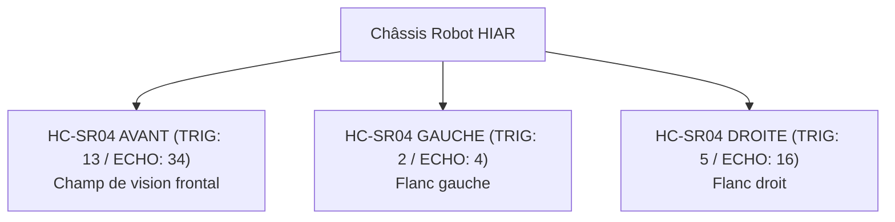
*Figure 7 : Implantation géométrique du triplet télémétrique ultrasonique sur le châssis*

#### Principe de mesure physique et formule mathématique
Le module HC-SR04 émet une salve de 8 impulsions acoustiques à 40 kHz suite à une impulsion de commande de 10 µs appliquée sur la broche `TRIG`. La broche `ECHO` bascule à l'état haut pendant une durée $\Delta t$ correspondant à l'aller-retour de l'onde ultrasonore réfléchie par l'obstacle. La distance métrique $d$ (en centimètres) est calculée par la relation physique :
$$d = \frac{v_{\text{son}} \times \Delta t}{2}$$
où $v_{\text{son}} \approx 343\text{ m/s}$ (soit $0,0343\text{ cm/\mu s}$) dans l'air sec à 20 °C. D'où la formule implémentée dans le firmware :
$$d_{\text{cm}} = \frac{\Delta t_{\mu\text{s}} \times 0,0343}{2} = \frac{\Delta t_{\mu\text{s}}}{58,3}$$

#### Algorithme de multiplexage séquentiel anti-interférences
Lorsque plusieurs transducteurs ultrasoniques fonctionnent simultanément à proximité immédiate, l'onde émise par un capteur peut frapper le récepteur du capteur adjacent (*phénomène d'écho croisé* ou *cross-talk*), provoquant des distances faussement courtes. 
Pour éliminer ce biais sans matériel additionnel, le firmware ESP32 applique un **multiplexage séquentiel temporel strict** :
1. Le capteur **Avant** est déclenché. Le firmware alloue un temps de vol maximal de $25\text{ ms}$ (correspondant à une distance théorique de 4,30 m) ;
2. Un temps de garde inter-ping de $35\text{ ms}$ est imposé pour dissiper les ondes rémanentes ;
3. Le capteur **Gauche** est déclenché, suivi du même intervalle de silence acoustique ;
4. Le capteur **Droit** est déclenché.

La période complète d'échantillonnage de la ceinture s'établit à :
$$T_{\text{cycle}} = 3 \times 35\text{ ms} = 105\text{ ms} \quad (\approx 9,5\text{ Hz})$$
Chaque mesure fait ensuite l'objet d'un **filtrage médian sur 3 échantillons consécutifs**, garantissant le rejet absolu des pics aberrants.

*Tableau 17 : Spécifications techniques du module HC-SR04 dans HIAR*

| Paramètre | Caractéristique nominale | Implémentation HIAR |
| :--- | :--- | :--- |
| **Tension d'alimentation** | 5,0 V continu | Alimenté depuis le rail 5V stabilisé du régulateur. |
| **Niveau logique ECHO** | 5,0 V TTL | Adapté à 3,3 V via pont diviseur résistif ($1\text{ k}\Omega / 2\text{ k}\Omega$) pour protéger les GPIO de l'ESP32. |
| **Portée utile** | 2 cm à 400 cm | Filtrée logiciellement entre 2 cm et 200 cm (seuil d'arrêt : 20 cm). |
| **Résolution angulaire** | Angle conique d'environ 15° | Couverture sectorielle Avant, Gauche et Droite. |

*Figure 6 : Module télémétrique ultrasonique HC-SR04 et chronogramme de temps de vol*

*Tableau 18 : Analyse comparative : Barrière infrarouge LM393 versus Triplet HC-SR04*

| Critère d'évaluation | Capteurs IR LM393 (version initiale) | Triplet HC-SR04 multiplexé (version retenue) |
| :--- | :--- | :--- |
| **Principe physique** | Réflexion optique infrarouge d'intensité | Temps de vol d'une onde acoustique à 40 kHz |
| **Sensibilité à l'albédo / couleur** | Très forte (surfaces sombres non détectées) | Insensible à la couleur et à la réflectance optique |
| **Sensibilité à la lumière ambiante** | Perturbé par l'éclairage zénithal et le soleil | Totalement insensible aux variations de luminosité |
| **Portée utile mesurée** | 2 cm à 30 cm (seuil analogique instable) | 2 cm à 200 cm (linéarité métrique précise) |
| **Nature de la donnée fournie** | Tout-ou-rien (binaire 0/1 sans distance) | Mesure métrique continue en centimètres |
| **Fiabilité en couloir hospitalier** | Médiocre (faux négatifs récurrents) | **Robuste et éprouvée (évitement sûr à 20 cm)** |

### 5.2.3. Capteurs physiologiques et chaîne de mesure biométrique
Le module de télémédecine préventive de HIAR permet de relever trois constantes physiologiques vitales à visée indicative :

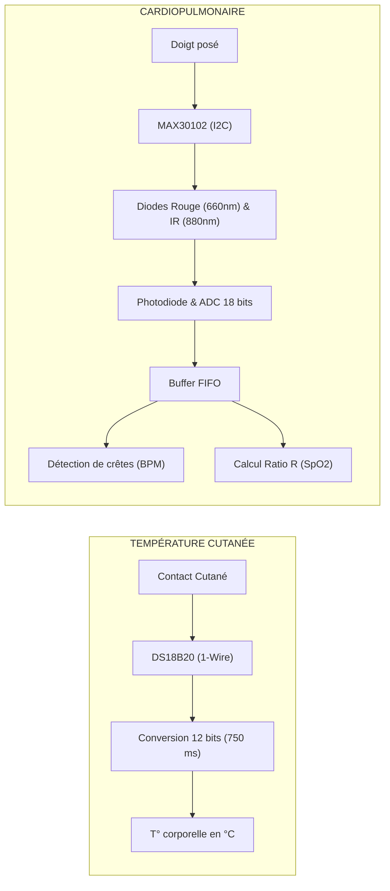
*Figure 8 : Synoptique de la chaîne d'acquisition biométrique (Température, Rythme cardiaque, SpO2)*

#### A. Température corporelle et capteur Dallas DS18B20
La thermorégulation humaine maintient la température centrale autour de 37,0 °C. La sonde DS18B20 encapsulée en acier inoxydable étanche permet une mesure cutanée directe par contact digital.
- **Protocole :** Bus 1-Wire utilisant un seul fil de données bidirectionnel (GPIO 23) associé à une résistance de rappel (*pull-up*) de 4,7 kΩ vers le 3,3 V.
- **Résolution :** Configurée en 12 bits, offrant un pas de quantification de $0,0625\text{ }^\circ\text{C}$ et une précision de $\pm 0,5\text{ }^\circ\text{C}$ dans la plage physiologique [30 °C – 45 °C].
- **Contrôle de plausibilité :** Rejet systématique des valeurs hors intervalle médical réaliste ($[25\text{ }^\circ\text{C} - 45\text{ }^\circ\text{C}]$).

#### B. Fréquence cardiaque et oxymétrie de pouls ($\text{SpO}_2$) par le capteur MAX30102
Le MAX30102 utilise la technique non invasive de **photopléthysmographie (PPG)** :
1. **Principe biophysique :** Le sang artériel contient deux formes principales d'hémoglobine ayant des spectres d'absorption optique distincts :
   - L'oxyhémoglobine ($\text{HbO}_2$), saturée en oxygène, absorbe préférentiellement la lumière infrarouge ($\lambda \approx 880\text{ nm}$) et laisse passer la lumière rouge ;
   - La désoxyhémoglobine ($\text{Hb}$), désoxygénée, absorbe fortement la lumière rouge ($\lambda \approx 660\text{ nm}$).
2. **Rythme cardiaque (BPM) :** À chaque onde pulsatile systolique, le volume sanguin capillaire varie, modulant l'intensité lumineuse réfléchie sur la photodiode. Le signal présente une composante continue (DC, tissus fixes et sang veineux) et une composante alternative pulsatile synchrone (AC). Un algorithme de détection de crêtes calcule l'intervalle temporel $\Delta t_{\text{beat}}$ entre deux systoles consécutives :
   $$\text{BPM} = \frac{60}{\Delta t_{\text{beat}}\text{ (s)}}$$
3. **Saturation pulsée en oxygène ($\text{SpO}_2$) :** Le firmware calcule le rapport de modulation normalisé $R$ (ratio des ratios) :
   $$R = \frac{(AC_{\text{rouge}} / DC_{\text{rouge}})}{(AC_{\text{IR}} / DC_{\text{IR}})}$$
   La saturation en oxygène est ensuite approximée par la courbe d'étalonnage empirique linéaire standard :
   $$\text{SpO}_{2}\text{ (\%)} \approx 110 - 25 \times R$$
   Cette valeur indicative est bornée entre 70 % et 100 %. Une valeur inférieure à 90 % traduit une hypoxie potentielle requérant une prise en charge médicale prioritaire.

*Tableau 19 : Synthèse des capteurs biométriques intégrés dans HIAR*

| Grandeur mesurée | Capteur utilisé | Bus matériel | Plage physiologique mesurée | Seuil d'acceptabilité |
| :--- | :--- | :--- | :--- | :--- |
| **Température cutanée** | DS18B20 | 1-Wire (GPIO 23) | $32,0\text{ }^\circ\text{C} - 42,0\text{ }^\circ\text{C}$ | Écart-type $< 0,5\text{ }^\circ\text{C}$ sur 5 échantillons |
| **Fréquence cardiaque** | MAX30102 | I2C (GPIO 21/22) | $45 - 180\text{ BPM}$ | Minimum 8 battements stables consécutifs |
| **Saturation $\text{SpO}_2$** | MAX30102 | I2C (GPIO 21/22) | $80\% - 100\%$ | Détection de doigt valide ($IR > 50\text{ }000$) |

### 5.2.4. Actionneurs et commande motrice différentielle
La base mobile de HIAR repose sur une architecture à entraînement différentiel (*two-wheel differential drive*) assistée d'une roue folle pivotante (*caster wheel*) :
- **Pont en H L298N :** Module de puissance à transistors bipolaires permettant la commande bidirectionnelle indépendante des deux moteurs à courant continu à réducteur (1:48) ;
- **Modulation PWM :** Générée par le périphérique LEDC de l'ESP32 à une fréquence de $20\text{ kHz}$ (au-dessus du spectre audible pour éliminer le sifflement acoustique) sur une résolution de 8 bits (rapport cyclique de 0 à 255). La vitesse de croisière est fixée à 65 % (PWM = 165) afin d'assurer un déplacement calme et sécurisant dans les allées hospitalières ;
- **Gestion de la cinématique et inversion de braquage :** La couche d'abstraction logicielle `esp32_interface_node.py` assure l'inversion sémantique (`invert_steering = True`) pour aligner fidèlement les consignes `LEFT` et `RIGHT` avec la géométrie physique des polarités moteur.

*Figure 9 : Module de puissance de commande des moteurs à double pont en H L298N*

*Figure 10 : Motoréducteurs à courant continu (moteurs DC) et cinématique différentielle*

*Tableau 20 : Caractéristiques électriques et gestion thermique du pont en H L298N*

| Paramètre électrique | Spécification nominale L298N | Conditionnement dans HIAR |
| :--- | :--- | :--- |
| **Tension d'alimentation logique ($V_{SS}$)** | 4,5 V à 7,0 V continu | 5,0 V régulé depuis le bus commun |
| **Tension de puissance moteur ($V_S$)** | Jusqu'à 46 V continu | 7,4 V nominaux (Pack 2x 18650 Li-ion en série) |
| **Courant de sortie continu par pont ($I_o$)** | 2,0 A par canal (crête à 3,0 A) | 0,6 A à 1,2 A sous charge mécanique hospitalière |
| **Tension de saturation bipolaire ($V_{CE(sat)}$)** | Typiquement 1,8 V à 1,0 A | Chute de tension admise absorbée par la réserve Li-ion |
| **Puissance dissipée maximale ($P_{tot}$)** | 25 W à $T_{case} = 75\text{ }^\circ\text{C}$ | Refroidissement passif par dissipateur à ailettes en aluminium |

*Tableau 21 : Synthèse complète des composants de perception et d'actionnement du robot*

| Sous-système | Équipement | Rôle fonctionnel principal | Interface matérielle / Bus | Taux d'échantillonnage |
| :--- | :--- | :--- | :--- | :--- |
| **Perception frontale** | HC-SR04 Avant | Détection d'obstacles dans l'axe de marche | TRIG 13 / ECHO 34 (Diviseur 5V/3.3V) | ~9,5 Hz (Cycle 105 ms) |
| **Perception latérale** | HC-SR04 Gauche | Détection d'obstacles flanc gauche et couloirs | TRIG 2 / ECHO 4 | ~9,5 Hz (Cycle 105 ms) |
| **Perception latérale** | HC-SR04 Droit | Détection d'obstacles flanc droit et couloirs | TRIG 5 / ECHO 16 | ~9,5 Hz (Cycle 105 ms) |
| **Biométrie thermique** | DS18B20 | Mesure de la température corporelle cutanée | GPIO 23 (Bus 1-Wire + 4,7 kΩ) | 1,3 Hz (Conversion 750 ms) |
| **Biométrie cardio** | MAX30102 | Fréquence cardiaque (BPM) et saturation ($\text{SpO}_2$) | GPIO 21/22 (Bus I²C Fast Mode 400 kHz) | 100 Hz (Buffer FIFO 32 éch.) |
| **Actionnement moteur** | Double pont L298N | Modulation de vitesse et inversion de sens | GPIO 25/26/27 et 19/14/18 | PWM 20 kHz (Résolution 8 bits) |

---

## 5.3. Technologies de connectivité et protocoles réseau

La communication au sein du système HIAR conjugue des protocoles adaptés aux différentes échelles physiques de transmission :

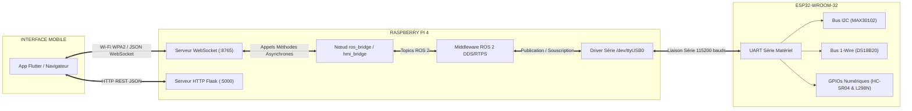
*Figure 11 : Matrice globale des protocoles et interfaces d'interconnexion du système HIAR*

### 5.3.1. Réseau local sans fil et WebSockets temps réel

*Tableau 22 : Caractéristiques de la communication réseau sans fil (Wi-Fi et WebSocket)*

| Paramètre | Spécification technique | Justification dans HIAR |
| :--- | :--- | :--- |
| **Norme radioélectrique** | IEEE 802.11 b/g/n (Wi-Fi 2,4 GHz) | Portée robuste à travers les cloisons hospitalières (~25 m en intérieur) |
| **Mode d'exploitation** | Point d'accès autonome (HostAP) | Autonomie complète sans infrastructure réseau préexistante |
| **Sécurité sans fil** | WPA2-Personal (AES-CCMP) | Protection contre les intrusions non autorisées sur le sous-réseau |
| **Plan d'adressage IP** | 10.42.0.0/24 (Passerelle 10.42.0.1) | Attribution automatique DHCP aux terminaux usagers et soignants |
| **Protocole applicatif temps réel** | WebSocket bidirectionnel (Port 8765) | Télémétrie push événementielle sans latence d'interrogation périodique |

- **Point d'accès Wi-Fi dédié (`HIAR-DEMO`) :** Généré directement par la carte Wi-Fi embarquée du Raspberry Pi 4 à l'aide de l'utilitaire `NetworkManager` (`nmcli`). Il crée un sous-réseau étanche (`192.168.43.0/24` ou `10.42.0.0/24`) sous chiffrement WPA2-Personal, immunisant le robot contre les défaillances de connexion externe.
- **Canal bidirectionnel WebSocket (`ws://IP:8765`) :** Protocole temps réel événementiel encadré par le contrat formel `WEBSOCKET_PROTOCOL.md`. Il véhicule les flux de télémétrie des capteurs, les requêtes d'orientation, la synchronisation des étapes du formulaire de consultation (`ui/state`), les déclenchements vocaux et les trames de diagnostic matériel en direct.

### 5.3.2. Liaison série asynchrone UART (Raspberry Pi $\longleftrightarrow$ ESP32)

*Tableau 23 : Spécifications de la liaison série bidirectionnelle UART (Raspberry Pi – ESP32)*

| Paramètre de transmission | Valeur configurée | Rôle dans l'architecture distribuée |
| :--- | :--- | :--- |
| **Vitesse de modulation (Baudrate)** | 115 200 bauds | Compromis idéal entre débit utile (~11,5 Ko/s) et immunité au bruit |
| **Trame de données (Format)** | 8 bits de données, sans parité, 1 bit d'arrêt (8N1) | Standard universel asynchrone sans surcoût de contrôle |
| **Contrôle de flux** | Aucun (contrôle logiciel par délimiteur \) | Réduction du nombre de broches d'interconnexion requises |
| **Encodage des messages** | Chaînes ASCII normalisées délimitées par virgules | Lisibilité immédiate, auditabilité et débogage simplifié |

*Tableau 24 : Protocoles matériels et caractéristiques d'échantillonnage des capteurs*

| Capteur / Périphérique | Bus matériel / Interface | Débit / Fréquence | Mode d'acquisition |
| :--- | :--- | :--- | :--- |
| **Ceinture 3x HC-SR04** | GPIO numériques (Impulsion 10 µs) | Cycle global de 105 ms (~9,5 Hz) | Multiplexage séquentiel à 35 ms |
| **Sonde Dallas DS18B20** | Bus 1-Wire (GPIO 23 + Pull-up) | Fréquence ~1,3 Hz (Temps conv. 750 ms) | Lecture de mot binaire numérique 12 bits |
| **Oxymètre MAX30102** | Bus I²C Fast Mode (400 kHz, 0x57) | Échantillonnage optique à 100 Hz | Buffer matériel FIFO de 32 échantillons |
| **Pilote moteur L298N** | Sorties PWM LEDC matérielles | Fréquence inaudible de 20 kHz | Modulation 8 bits du rapport cyclique [0-255] |

*Tableau 25 : Matrice d'évaluation des risques de communication et contre-mesures*

| Risque de communication | Impact sur le système | Contre-mesure architecturale déployée |
| :--- | :--- | :--- |
| **Déconnexion de la liaison série USB** | Perte de contrôle motrice | Nœud esp32_interface_node en reconnexion automatique + Arrêt d'urgence firmware (2 s) |
| **Perte de signal Wi-Fi usager** | Interruption de la session | Maintien de l'état en base SQLite locale + Reconcordance WebSocket immédiate |
| **Collision acoustique (inter-ping ultrasons)** | Mesures courtes erronées | Multiplexage séquentiel temporel à 35 ms et filtre médian sur 3 points |
| **Surcharge des messages ROS 2** | Engorgement mémoire | Files d'attente QoS bornées (depth=10) avec politique de remplacement du plus ancien |

La liaison filaire USB-Série relie le port USB du Raspberry Pi (`/dev/ttyUSB0`) au contrôleur UART de l'ESP32 :
- **Paramètres :** Débit de 115 200 bauds, 8 bits de données, sans parité, 1 bit d'arrêt (8N1).
- **Format des trames :** Messages textuels concis délimités par des virgules et terminés par le caractère de fin de ligne `\n` :
  - *Consignes descendantes (Pi $\to$ ESP32) :* `FORWARD\n`, `BACKWARD\n`, `LEFT\n`, `RIGHT\n`, `STOP\n`, `MEASURE\n`, `PING\n`, `STATUS\n`.
  - *Télémétrie montante (ESP32 $\to$ Pi) :* `DIST,<cm>\n`, `DIST_L,<cm>\n`, `DIST_R,<cm>\n`, `RESULT,TEMP:<val>,HR:<val>,SPO2:<val>\n`, `HEALTH,temp:1,pulse:1,us:1,motors:1\n`, `SAFETY,OBSTACLE,<cm>\n`.

---

## 5.4. Modélisation schématique et graphe des flux

### 5.4.1. Graphe des nœuds et des topics ROS 2

*Tableau 26 : Structure fonctionnelle de l'interface applicative multi-écrans*

| Écran / Module Flutter | Rôle fonctionnel | Données échangées |
| :--- | :--- | :--- |
| **Module Accueil** | État global du robot, sélecteur de langue et saisie libre | Transcription vocale STT, synthèse TTS, état batterie |
| **Module Orientation** | Cartographie simplifiée des 5 services hospitaliers cibles | Consignes de guidage, sélection destination, accusés d'arrivée |
| **Module Consultation** | Formulaire d'inscription, sélection du médecin et période | Nom, contact normalisé (+261...), code praticien, créneau |
| **Module Signes Vitaux** | Vidéo MP4 didactique et visualisation des mesures | Barres de progression 20 s, valeurs T°, BPM, SpO2 (sans TTS) |
| **Portail Web Soignant** | Appel des patients, clôture de consultation et monitoring | Jetons d'authentification HMAC, liste de file d'attente |

*Tableau 27 : Répartition des responsabilités logicielles entre les nœuds ROS 2*

| Nœud ROS 2 | Fichier source Python | Responsabilité exclusive | Fréquence de boucle |
| :--- | :--- | :--- | :--- |
|  |  | Serveur WebSocket :8765, routage NLU et sessions | Événementielle asynchrone |
|  |  | Machine à états finis (FSM) de guidage et décision | Événementielle / 5 Hz |
|  |  | Watchdog prioritaire, sécurité motrice déterministe | Périodique stricte à 10,0 Hz |
|  |  | Qualification des distances seuils à 20 cm | Périodique synchrone à 10,0 Hz |
|  |  | Passerelle série USB et inversion cinématique | Cadencée trames série à 20 Hz |

*Tableau 28 : Flux d'entrées, traitements et sorties des services métiers de HIAR*

| Service métier | Données en entrée | Traitements appliqués | Données en sortie |
| :--- | :--- | :--- | :--- |
| **Orientation** | Destination choisie ou mot-clé vocal | Résolution cartographique, planification FSM | Trajectoire d'avance et braquage moteurs |
| **Consultation** | Identité patient, contact, médecin | Vérification ouverture session, unicité créneau | Ticket séquentiel numérique (ex. A-MAT-1) |
| **Biométrie** | Signaux bruts 1-Wire et I²C | Filtrage médian, détection de crêtes, ratio R | Constantes T°, BPM, SpO2 affichées à l'écran |
| **Assistance NLU** | Phrase en langage naturel (texte/voix) | Regex réflexe, requête Gemini Cloud ou Qwen Edge | Intention JSON et réponse audio de guidage |

Le cœur décisionnel de HIAR repose sur **cinq nœuds ROS 2 modulaires** écrits en Python :

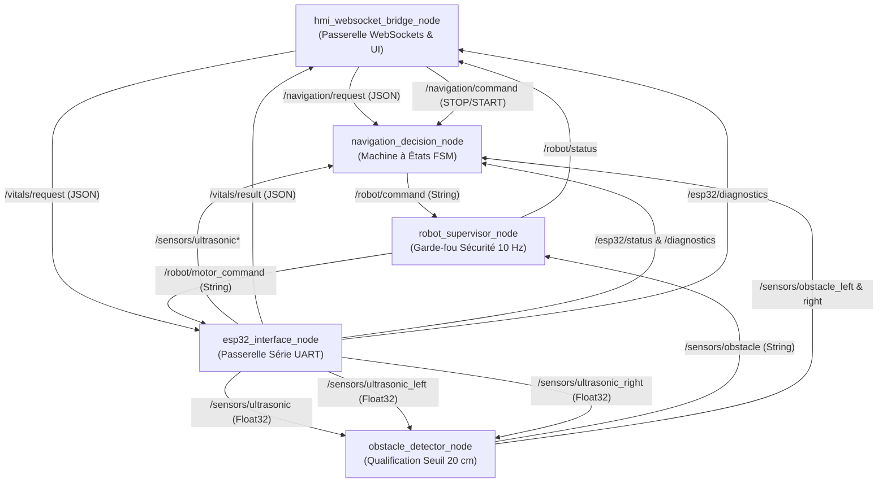
*Figure 14 : Graphe exhaustif des nœuds et des topics de communication ROS 2 Humble*

*Tableau 34 : Dictionnaire des topics ROS 2 du système HIAR*

| Nom du Topic ROS 2 | Type de message | Nœud émetteur | Nœud récepteur | Sémantique fonctionnelle |
| :--- | :--- | :--- | :--- | :--- |
| `/navigation/request` | `std_msgs/String` (JSON) | `hmi_websocket_bridge` | `navigation_decision` | Ordre d'orientation validé vers une destination hospitalière. |
| `/navigation/command` | `std_msgs/String` | `hmi_websocket_bridge` | `navigation_decision` | Commande manuelle ou vocale (`START`, `STOP`, `FORWARD`, etc.). |
| `/sensors/ultrasonic` | `std_msgs/Float32` | `esp32_interface` | `obstacle_detector`, `decision` | Distance mesurée par le capteur ultrasonique frontal (cm). |
| `/sensors/ultrasonic_left`| `std_msgs/Float32` | `esp32_interface` | `obstacle_detector`, `decision` | Distance mesurée par le capteur ultrasonique gauche (cm). |
| `/sensors/ultrasonic_right`| `std_msgs/Float32`| `esp32_interface` | `obstacle_detector`, `decision` | Distance mesurée par le capteur ultrasonique droit (cm). |
| `/sensors/obstacle` | `std_msgs/String` | `obstacle_detector` | `robot_supervisor` | État qualifié frontal (`CLEAR` ou `OBSTACLE` si $< 20\text{ cm}$). |
| `/robot/command` | `std_msgs/String` | `navigation_decision` | `robot_supervisor` | Consigne motrice calculée par la machine à états de navigation. |
| `/robot/motor_command` | `std_msgs/String` | `robot_supervisor` | `esp32_interface` | Consigne motrice autorisée après filtrage de sécurité. |
| `/vitals/request` | `std_msgs/String` (JSON) | `hmi_websocket_bridge` | `esp32_interface` | Ordre de lancement d'une session de mesure biométrique. |
| `/vitals/result` | `std_msgs/String` (JSON) | `esp32_interface` | `hmi_websocket_bridge` | Résultats consolidés de température, pouls et $\text{SpO}_2$. |
| `/esp32/diagnostics` | `std_msgs/String` (JSON) | `esp32_interface` | `hmi_websocket_bridge` | Snapshot de santé matérielle temps réel (Option B). |

---

## 5.5. Analyse comparative des modèles de référence normalisés

La structure cyber-physique de HIAR a été rigoureusement confrontée aux deux normes internationales de référence pour l'Internet des Objets :
1. **Recommandation UIT-T Y.4000/Y.2060 (Union Internationale des Télécommunications) :** Modèle conceptuel définissant les exigences fondamentales d'interconnexion, de gestion des dispositifs hétérogènes et de sécurité de l'information.
2. **Norme ISO/IEC 30141:2024 (Architecture de référence pour l'IoT) :** Cadre international fournissant des vues architecturales normalisées (vue fonctionnelle, vue système, vue de confiance et de sécurité).

*Tableau 29 : Comparaison synoptique des modèles de référence et correspondance avec HIAR*

| Critère normatif | Modèle UIT-T Y.4000 / Y.2060 | Norme ISO/IEC 30141:2024 | Application concrète dans le robot HIAR |
| :--- | :--- | :--- | :--- |
| **Couche Dispositifs (Perception)** | Dispositifs physiques avec capacités de détection et d'actionnement. | Entités physiques du domaine physique (*Sensors / Actuators*). | Triplet HC-SR04, sonde DS18B20, capteur MAX30102 et moteurs DC pilotés par l'ESP32. |
| **Couche Réseau (Connectivité)** | Capacités de transport réseau et de communication locale. | Domaine de connectivité réseau (*Network Connectivity*). | Wi-Fi HostAP local (WPA2), WebSockets asynchrones et bus de terrain UART / I2C / 1-Wire. |
| **Couche Support & Traitement** | Traitement des données, calculs génériques et stockage. | Domaine des opérations et de traitement des données. | Système d'exploitation Ubuntu 22.04 LTS, nœuds ROS 2, base relationnelle SQLite locale. |
| **Couche Application** | Applications métiers et interfaces utilisateurs spécifiques. | Domaine des applications et services aux usagers. | Application Flutter « Neo Clinic », portail Flask pour le personnel médical, dialogue IA. |
| **Sécurité & Confiance** | Sécurité transversale et protection de la vie privée. | Vue transversale de confiance (*Trustworthiness / Privacy / Safety*). | Superviseur temps réel 10 Hz, non-vocalisation des constantes médicales, authentification par jetons. |

*Tableau 30 : Cartographie d'alignement de l'architecture HIAR avec les normes IoT*

| Couche UIT-T Y.4000 | Domaine ISO/IEC 30141 | Éléments d'implémentation HIAR | Mécanismes d'assurance qualité associés |
| :--- | :--- | :--- | :--- |
| **Application** | User & Application Domain | Application Flutter « Neo Clinic » & Portail Web Flask | Tests automatisés des routes et validation de schémas JSON |
| **Support / Service** | Service & Data Domain | Base SQLite, Serveur WebSocket, Service IA hybride | Transactions ACID  et cache LRU |
| **Réseau** | Network Domain | Wi-Fi local WPA2 (HIAR-DEMO), Middleware ROS 2 Humble | Isolation des flux, sous-réseau dédié et protocoles typés |
| **Dispositif** | Physical Domain | ESP32, 3x HC-SR04, DS18B20, MAX30102, Châssis L298N | Filtrage médian 3 points, coupure matérielle d'urgence (< 25 cm) |


---

## 5.6. Limites techniques et défis assumés de l'architecture

Dans le cadre d'une démarche scientifique d'ingénierie honnête, le prototype HIAR assume des frontières fonctionnelles claires découlant de son positionnement *low-cost* :
- **Absence de localisation cartographique absolue (SLAM / LiDAR) :** Ne disposant ni d'un scanner LiDAR ni d'odométrie sur les roues motrices, le robot ne maintient pas une carte métrique dynamique de l'espace. Le guidage physique relève d'une **simulation d'accompagnement réactive** délimitée par une durée maximale de mission ($30\text{ s}$) et un évitement d'obstacles local.
- **Portée indicative des grandeurs physiologiques :** Les capteurs DS18B20 et MAX30102 constituent des modules d'évaluation indicatifs non certifiés au sens de la directive médicale CE/FDA. Ils visent à enrichir la pré-consultation mais ne sauraient en aucun cas fonder une prescription ou un diagnostic clinique sans validation humaine par un médecin assermenté.
- **Gestion thermique du pont en H L298N :** En raison de la chute de tension interne propre aux ponts bipolaires (~2 V), le circuit L298N dissipe une énergie thermique non négligeable lors de sollicitations motrices prolongées. Des temps de repos logiciels sont intégrés dans les scénarios de test.

*Tableau 31 : Limites techniques intrinsèques du prototype et mesures d'atténuation*

| Limite technique identifiée | Cause racine matérielle / logicielle | Mesure d'atténuation opérationnelle déployée |
| :--- | :--- | :--- |
| **Absence de carte SLAM / LiDAR** | Choix d'ingénierie frugale (low-cost) | Guidage réactif déterministe borné par timeout (30 s) |
| **Glissement des roues motrices** | Absence de codeurs incrémentaux en quadrature | Déplacements à vitesse modérée (65 % PWM) sur sols plats |
| **Caractère indicatif des vitaux** | Capteurs de surface non certifiés CE médical | Affichage préventif explicite et non-substitution au médecin |
| **Échauffement du pont L298N** | Chute de tension interne des transistors bipolaires | Dissipateur passif en aluminium et temporisations de repos |


---

# Chapitre 6. Méthodologie

Ce chapitre expose les démarches de conception matérielle et logicielle, les diagrammes formels UML, la modélisation des données relationnelles, la politique de cybersécurité ainsi que l'architecture du double moteur d'intelligence artificielle.

---

## 6.1. Modélisation et conception de la solution

*Tableau 32 : Grille d'arbitrage technologique détaillée par domaine d'ingénierie*

| Domaine technique | Option écartée | Option retenue dans HIAR | Justification scientifique et technique |
| :--- | :--- | :--- | :--- |
| **Middleware robotique** | ROS 1 Noetic | **ROS 2 Humble (LTS)** | Architecture temps réel sans roscore centralisé, QoS adaptative |
| **Perception d'obstacles** | 1x HC-SR04 + 2x IR LM393 | **Ceinture 3x HC-SR04 multiplexée** | Insensibilité totale aux variations lumineuses et à la couleur des sols |
| **Framework d'interface mobile** | React Native / PWA | **Flutter (Dart native)** | Performances graphiques AOT 60 FPS, support WebSocket temps réel |
| **Moteur d'intelligence artificielle** | Cloud pur ou Modèle TF-IDF | **Double détente : Gemini 2.5 Flash + Qwen local** | Richesse sémantique en ligne et continuité de service hors-ligne |
| **Persistance des données** | Fichiers JSON plats ou PostgreSQL | **SQLite3 embarqué transactionnel** | Zéro administration, empreinte mémoire minimale, intégrité ACID |


### 6.1.1. Diagramme de cas d'utilisation global (UML)
Le système HIAR interagit avec trois profils d'acteurs identifiés : le **Patient / Usager**, le **Personnel Médical (Médecin)** et le **Personnel Soignant d'Accueil**.

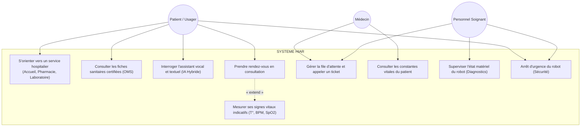
*Figure 13 : Diagramme de cas d'utilisation global du système HIAR*

### 6.1.2. Diagramme de classes des composants logiciels (UML)
L'architecture orientée objet du socle ROS 2 et des services applicatifs structure les responsabilités :

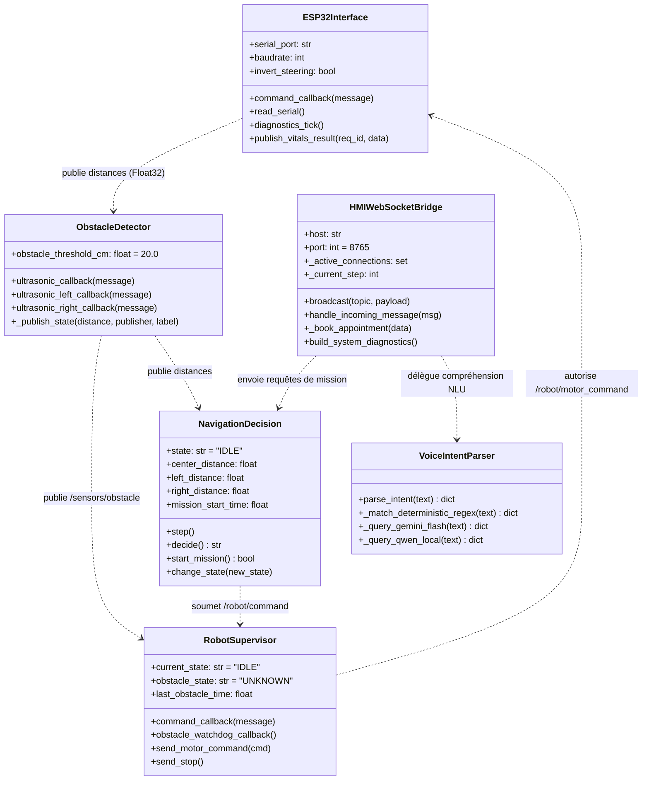
*Figure 15 : Diagramme de classes simplifié des composants logiciels clés de HIAR*

---

## 6.2. Modélisation de la navigation autonome et sécurité

Le déroulement nominal d'une mission d'accompagnement initiée par un usager vers un service hospitalier cible est modélisé par la séquence des échanges entre l'IHM, ROS 2 et les actionneurs :

*Figure 16 : Diagramme de séquence du scénario d'orientation et de guidage vers un service hospitalier*

*Tableau 33 : Affectation exhaustive des broches GPIO de l'ESP32*

| Broche GPIO | Fonction matérielle | Composant relié | Précautions et adaptations de niveau |
| :--- | :--- | :--- | :--- |
| **GPIO 13 / 34** | TRIG (Sortie) / ECHO (Entrée) | HC-SR04 Avant | Pont diviseur 	ext{ k}\Omega / 2	ext{ k}\Omega$ sur GPIO 34 (Input-only) |
| **GPIO 2 / 4** | TRIG (Sortie) / ECHO (Entrée) | HC-SR04 Gauche | Connexion directe niveau logique 3,3 V |
| **GPIO 5 / 16** | TRIG (Sortie) / ECHO (Entrée) | HC-SR04 Droit | Connexion directe niveau logique 3,3 V |
| **GPIO 23** | Ligne de données DATA | Sonde Dallas DS18B20 | Résistance de rappel (*pull-up*) externe 4,7 kΩ vers 3,3 V |
| **GPIO 21 / 22** | Lignes SDA / SCL (Bus I²C) | Capteur MAX30102 | Fast Mode 400 kHz (Adresse matérielle 0x57) |
| **GPIO 25 / 26 / 27** | ENA (PWM) / IN1 / IN2 (Sens) | Moteur Gauche (Pont L298N) | Canal PWM matériel LEDC 20 kHz sur 8 bits |
| **GPIO 19 / 14 / 18** | ENB (PWM) / IN3 / IN4 (Sens) | Moteur Droit (Pont L298N) | Canal PWM matériel LEDC 20 kHz sur 8 bits |
| **GPIO 1 / 3** | TXD0 / RXD0 (Port Série natif) | Raspberry Pi 4 USB | Liaison USB-UART à 115200 bauds (/dev/ttyUSB0) |

### 6.2.1. Machine à états finis (FSM) de navigation réactive
La prise de décision de déplacement autonome est modélisée par une **Machine à États Finis (FSM)** strictement déterministe intégrée au nœud `navigation_decision_node.py` :

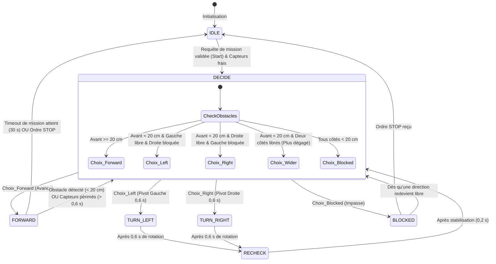
*Figure 17 : Machine à états finis (FSM) de la navigation autonome réactive*

### 6.2.2. Algorithme de décision d'évitement d'obstacles
Le cœur décisionnel de la méthode `decide()` analyse en permanence le triplet de capteurs :
1. **Voie frontale libre ($d_{\text{front}} \ge 20,0\text{ cm}$) :** Le robot maintient sa trajectoire nominale et avance tout droit (`FORWARD`).
2. **Obstacle frontal détecté ($d_{\text{front}} < 20,0\text{ cm}$) :** Le robot s'arrête immédiatement et consulte ses deux capteurs latéraux :
   - *Si Gauche est libre ($\ge 20\text{ cm}$) et Droite bloquée ($< 20\text{ cm}$) :* Rotation immédiate à gauche (`LEFT`) ;
   - *Si Droite est libre ($\ge 20\text{ cm}$) et Gauche bloquée ($< 20\text{ cm}$) :* Rotation immédiate à droite (`RIGHT`) ;
   - *Si les deux côtés sont dégagés :* Évitement vers le côté offrant le dégagement spatial maximal ($d_{\text{droite}} > d_{\text{gauche}} + 5\text{ cm} \implies \text{RIGHT}$, sinon $\text{LEFT}$) ;
   - *Si les deux côtés sont bloqués :* Transition vers l'état `BLOCKED` (arrêt sécuritaire total).

### 6.2.3. Diagramme de séquence : Détection et évitement d'obstacle
Le diagramme suivant illustre le flux dynamique des messages lors de la rencontre inopinée d'un obstacle frontal :

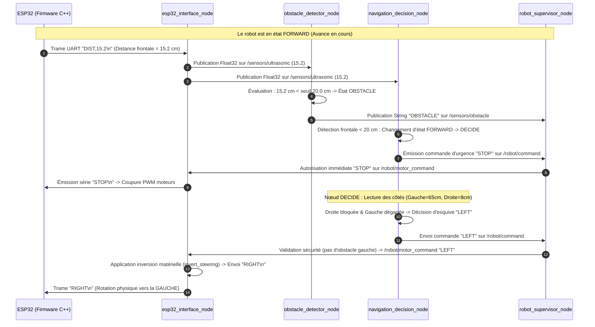
*Figure 18 : Diagramme de séquence de la détection et du contournement dynamique d'obstacle*

---

## 6.3. Modélisation des données et persistance locale (SQLite)

Le stockage local des inscriptions de consultation et des rendez-vous hospitaliers repose sur une base relationnelle SQLite locale (`appointments.sqlite3`), régie par le principe d'atomicité transactionnelle **ACID** au moyen de transactions `BEGIN IMMEDIATE`.

### 6.3.1. Modèle Physique des Données (MPD)

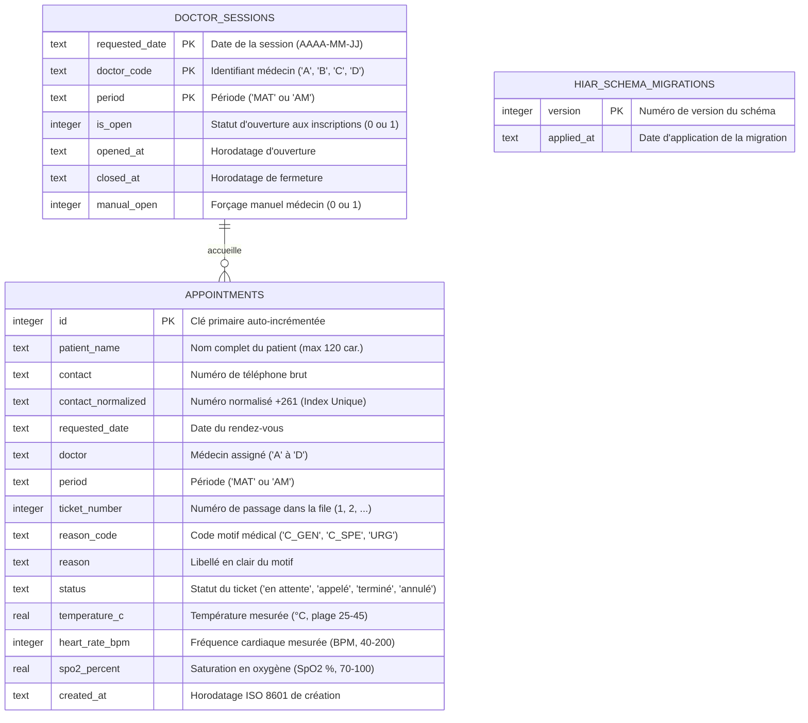
*Figure 19 : Modèle Physique des Données (MPD) de la base relationnelle SQLite locale*

### 6.3.2. Règles d'intégrité et gestion de la concurrence
Le schéma SQLite applique quatre contraintes d'intégrité strictes :
1. **Prévention des doublons par index unique partiel :** Un même numéro de téléphone ne peut s'inscrire qu'une seule fois par jour calendaire, tous médecins confondus :
   ```sql
   CREATE UNIQUE INDEX idx_unique_daily_contact 
   ON appointments(contact_normalized, requested_date);
   ```
   Toute tentative concurrente est immédiatement rejetée avec un code d'erreur HTTP 409 (*Conflict*).
2. **Génération séquentielle de tickets sans trou :** Calcul du ticket par `COALESCE(MAX(ticket_number), 0) + 1` exécuté dans un verrou exclusif `BEGIN IMMEDIATE`, garantissant l'absence de tickets en double même sous requêtes HTTP simultanées.
3. **Machine à états finis du cycle de vie des tickets :**

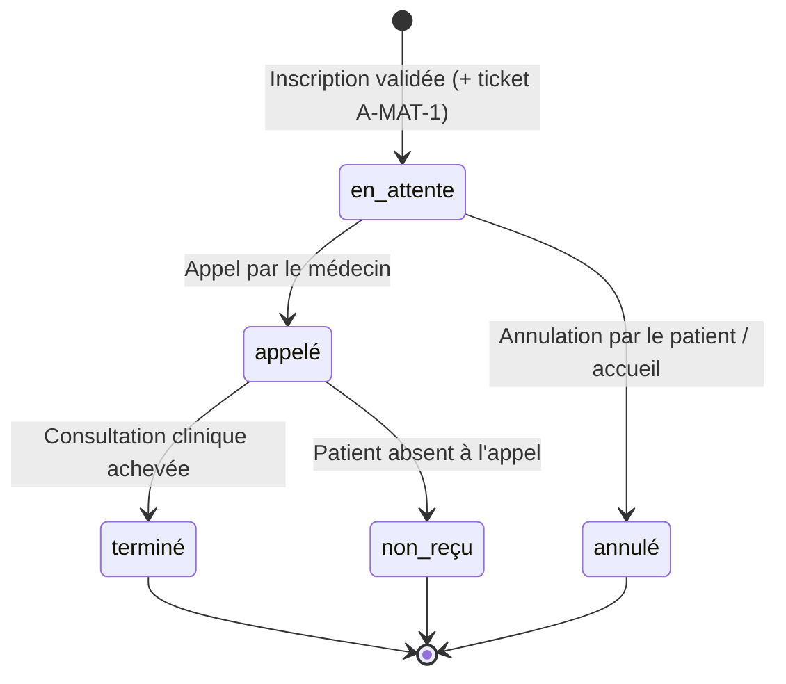
*Figure 20 : Cycle de vie et transitions d'état d'un ticket de consultation hospitalière*

Le diagramme de séquence ci-après détaille l'enchaînement temporel de l'inscription en consultation, de l'acquisition biométrique conjointe et de l'attribution transactionnelle du ticket :

*Figure 21 : Diagramme de séquence de la prise de rendez-vous et de l'acquisition des signes vitaux*

*Tableau 35 : Règles métier du service de consultation et d'attribution des tickets*

| Règle métier | Condition d'application | Mécanisme de contrôle applicatif et base |
| :--- | :--- | :--- |
| **Plage de consultation autorisée** | Date supérieure ou égale à la date du jour | Validation de schéma dans l'API Flask (code 400 si date passée) |
| **Session praticien ouverte** | Session configurée à  | Vérification transactionnelle de la table  |
| **Unicité patient par demi-journée** | Un seul rendez-vous par numéro par période | Index unique partiel  |
| **Numérotation séquentielle des tickets** | Incrémentation continue par demi-journée | Calcul atomique  sous  |
| **Plage de validité biométrique** | Valeurs physiologiques humaines plausibles |  \in [25, 45	ext{ }^\circ	ext{C}]$,  \in [40, 200]$, $	ext{SpO}_2 \in [70, 100\%]$ |

*Tableau 36 : Couches intégrées du système HIAR et principes de contrôle*

| Niveau architectural | Sous-système concerné | Principe de sanctuarisation et de contrôle |
| :--- | :--- | :--- |
| **Niveau I : Interface usager** | Application Flutter « Neo Clinic » | Validation syntaxique stricte, aucune commande motrice directe possible |
| **Niveau II : Intelligence artificielle** | Dual-Engine (Gemini + Qwen) | Traitement NLU purement déclaratif, sortie contrainte en schéma JSON |
| **Niveau III : Décision de navigation** | Nœud ROS 2  | Transition déterministe via FSM, surveillance du timeout mission (30 s) |
| **Niveau IV : Supervision déterministe** | Nœud ROS 2  | Watchdog 10 Hz, priorité absolue d'arrêt si obstacle frontal détecté |
| **Niveau V : Actionnement matériel** | Firmware ESP32 & Châssis L298N | Coupure matérielle autonome si obstacle < 25 cm ou perte de trame (> 2 s) |


---

*Tableau 37 : Niveaux de preuve et critères formels de qualification*

| Niveau de preuve | Définition méthodologique | Critère d'acceptation dans l'étude |
| :--- | :--- | :--- |
| **Preuve formelle de conformité logicielle** | Exécution de tests unitaires automatisés | 100 % de réussite sur la suite de 168 tests ============================= test session starts ==============================
platform linux -- Python 3.13.5, pytest-9.2.0, pluggy-1.7.0
rootdir: /home/franck/Documents/Cecilia/hospital_assistant_robot
plugins: anyio-4.8.0, typeguard-4.4.2
collected 28 items / 20 errors

==================================== ERRORS ====================================
_________ ERROR collecting src/hospital_robot/test/test_diagnostics.py _________
ImportError while importing test module '/home/franck/Documents/Cecilia/hospital_assistant_robot/src/hospital_robot/test/test_diagnostics.py'.
Hint: make sure your test modules/packages have valid Python names.
Traceback:
/usr/lib/python3.13/importlib/__init__.py:88: in import_module
    return _bootstrap._gcd_import(name[level:], package, level)
           ^^^^^^^^^^^^^^^^^^^^^^^^^^^^^^^^^^^^^^^^^^^^^^^^^^^^
src/hospital_robot/test/test_diagnostics.py:9: in <module>
    from hospital_robot.hmi_websocket_bridge_node import HMIWebSocketBridgeNode
E   ModuleNotFoundError: No module named 'hospital_robot'
____ ERROR collecting src/hospital_robot/test/test_esp32_interface_node.py _____
ImportError while importing test module '/home/franck/Documents/Cecilia/hospital_assistant_robot/src/hospital_robot/test/test_esp32_interface_node.py'.
Hint: make sure your test modules/packages have valid Python names.
Traceback:
/usr/lib/python3.13/importlib/__init__.py:88: in import_module
    return _bootstrap._gcd_import(name[level:], package, level)
           ^^^^^^^^^^^^^^^^^^^^^^^^^^^^^^^^^^^^^^^^^^^^^^^^^^^^
src/hospital_robot/test/test_esp32_interface_node.py:6: in <module>
    from hospital_robot.esp32_interface_node import ESP32Interface
E   ModuleNotFoundError: No module named 'hospital_robot'
______ ERROR collecting src/hospital_robot/test/test_hmi_request_node.py _______
ImportError while importing test module '/home/franck/Documents/Cecilia/hospital_assistant_robot/src/hospital_robot/test/test_hmi_request_node.py'.
Hint: make sure your test modules/packages have valid Python names.
Traceback:
/usr/lib/python3.13/importlib/__init__.py:88: in import_module
    return _bootstrap._gcd_import(name[level:], package, level)
           ^^^^^^^^^^^^^^^^^^^^^^^^^^^^^^^^^^^^^^^^^^^^^^^^^^^^
src/hospital_robot/test/test_hmi_request_node.py:5: in <module>
    from hospital_robot.hmi_request_node import HMIRequestReceiver
E   ModuleNotFoundError: No module named 'hospital_robot'
____ ERROR collecting src/hospital_robot/test/test_hmi_websocket_bridge.py _____
ImportError while importing test module '/home/franck/Documents/Cecilia/hospital_assistant_robot/src/hospital_robot/test/test_hmi_websocket_bridge.py'.
Hint: make sure your test modules/packages have valid Python names.
Traceback:
/usr/lib/python3.13/importlib/__init__.py:88: in import_module
    return _bootstrap._gcd_import(name[level:], package, level)
           ^^^^^^^^^^^^^^^^^^^^^^^^^^^^^^^^^^^^^^^^^^^^^^^^^^^^
src/hospital_robot/test/test_hmi_websocket_bridge.py:16: in <module>
    from hospital_robot.hmi_websocket_bridge_node import HMIWebSocketBridgeNode, String
E   ModuleNotFoundError: No module named 'hospital_robot'
______ ERROR collecting src/hospital_robot/test/test_llm_intent_engine.py ______
ImportError while importing test module '/home/franck/Documents/Cecilia/hospital_assistant_robot/src/hospital_robot/test/test_llm_intent_engine.py'.
Hint: make sure your test modules/packages have valid Python names.
Traceback:
/usr/lib/python3.13/importlib/__init__.py:88: in import_module
    return _bootstrap._gcd_import(name[level:], package, level)
           ^^^^^^^^^^^^^^^^^^^^^^^^^^^^^^^^^^^^^^^^^^^^^^^^^^^^
src/hospital_robot/test/test_llm_intent_engine.py:11: in <module>
    from hospital_robot.llm_intent_engine import (
E   ModuleNotFoundError: No module named 'hospital_robot'
__ ERROR collecting src/hospital_robot/test/test_navigation_decision_node.py ___
ImportError while importing test module '/home/franck/Documents/Cecilia/hospital_assistant_robot/src/hospital_robot/test/test_navigation_decision_node.py'.
Hint: make sure your test modules/packages have valid Python names.
Traceback:
/usr/lib/python3.13/importlib/__init__.py:88: in import_module
    return _bootstrap._gcd_import(name[level:], package, level)
           ^^^^^^^^^^^^^^^^^^^^^^^^^^^^^^^^^^^^^^^^^^^^^^^^^^^^
src/hospital_robot/test/test_navigation_decision_node.py:3: in <module>
    from hospital_robot.navigation_decision_node import NavigationDecision
E   ModuleNotFoundError: No module named 'hospital_robot'
______ ERROR collecting src/hospital_robot/test/test_robot_supervisor.py _______
ImportError while importing test module '/home/franck/Documents/Cecilia/hospital_assistant_robot/src/hospital_robot/test/test_robot_supervisor.py'.
Hint: make sure your test modules/packages have valid Python names.
Traceback:
/usr/lib/python3.13/importlib/__init__.py:88: in import_module
    return _bootstrap._gcd_import(name[level:], package, level)
           ^^^^^^^^^^^^^^^^^^^^^^^^^^^^^^^^^^^^^^^^^^^^^^^^^^^^
src/hospital_robot/test/test_robot_supervisor.py:5: in <module>
    from hospital_robot.robot_supervisor import RobotSupervisor
E   ModuleNotFoundError: No module named 'hospital_robot'
_____ ERROR collecting src/hospital_robot/test/test_vitals_data_parser.py ______
ImportError while importing test module '/home/franck/Documents/Cecilia/hospital_assistant_robot/src/hospital_robot/test/test_vitals_data_parser.py'.
Hint: make sure your test modules/packages have valid Python names.
Traceback:
/usr/lib/python3.13/importlib/__init__.py:88: in import_module
    return _bootstrap._gcd_import(name[level:], package, level)
           ^^^^^^^^^^^^^^^^^^^^^^^^^^^^^^^^^^^^^^^^^^^^^^^^^^^^
src/hospital_robot/test/test_vitals_data_parser.py:4: in <module>
    from hospital_robot.vitals_data_parser import (
E   ModuleNotFoundError: No module named 'hospital_robot'
_____ ERROR collecting src/hospital_robot/test/test_voice_intent_parser.py _____
ImportError while importing test module '/home/franck/Documents/Cecilia/hospital_assistant_robot/src/hospital_robot/test/test_voice_intent_parser.py'.
Hint: make sure your test modules/packages have valid Python names.
Traceback:
/usr/lib/python3.13/importlib/__init__.py:88: in import_module
    return _bootstrap._gcd_import(name[level:], package, level)
           ^^^^^^^^^^^^^^^^^^^^^^^^^^^^^^^^^^^^^^^^^^^^^^^^^^^^
src/hospital_robot/test/test_voice_intent_parser.py:4: in <module>
    from hospital_robot.voice_intent_parser import VoiceIntentParser, normalize_text
E   ModuleNotFoundError: No module named 'hospital_robot'
_______________ ERROR collecting web_interface/tests/test_api.py _______________
ImportError while importing test module '/home/franck/Documents/Cecilia/hospital_assistant_robot/web_interface/tests/test_api.py'.
Hint: make sure your test modules/packages have valid Python names.
Traceback:
/usr/lib/python3.13/importlib/__init__.py:88: in import_module
    return _bootstrap._gcd_import(name[level:], package, level)
           ^^^^^^^^^^^^^^^^^^^^^^^^^^^^^^^^^^^^^^^^^^^^^^^^^^^^
web_interface/tests/test_api.py:1: in <module>
    import app as app_module
E   ModuleNotFoundError: No module named 'app'
_____ ERROR collecting web_interface/tests/test_appointments_migration.py ______
ImportError while importing test module '/home/franck/Documents/Cecilia/hospital_assistant_robot/web_interface/tests/test_appointments_migration.py'.
Hint: make sure your test modules/packages have valid Python names.
Traceback:
/usr/lib/python3.13/importlib/__init__.py:88: in import_module
    return _bootstrap._gcd_import(name[level:], package, level)
           ^^^^^^^^^^^^^^^^^^^^^^^^^^^^^^^^^^^^^^^^^^^^^^^^^^^^
web_interface/tests/test_appointments_migration.py:5: in <module>
    from appointments_store import init_db, list_appointments
E   ModuleNotFoundError: No module named 'appointments_store'
_______ ERROR collecting web_interface/tests/test_appointments_store.py ________
ImportError while importing test module '/home/franck/Documents/Cecilia/hospital_assistant_robot/web_interface/tests/test_appointments_store.py'.
Hint: make sure your test modules/packages have valid Python names.
Traceback:
/usr/lib/python3.13/importlib/__init__.py:88: in import_module
    return _bootstrap._gcd_import(name[level:], package, level)
           ^^^^^^^^^^^^^^^^^^^^^^^^^^^^^^^^^^^^^^^^^^^^^^^^^^^^
web_interface/tests/test_appointments_store.py:3: in <module>
    from appointments_store import (
E   ModuleNotFoundError: No module named 'appointments_store'
___________ ERROR collecting web_interface/tests/test_booking_api.py ___________
ImportError while importing test module '/home/franck/Documents/Cecilia/hospital_assistant_robot/web_interface/tests/test_booking_api.py'.
Hint: make sure your test modules/packages have valid Python names.
Traceback:
/usr/lib/python3.13/importlib/__init__.py:88: in import_module
    return _bootstrap._gcd_import(name[level:], package, level)
           ^^^^^^^^^^^^^^^^^^^^^^^^^^^^^^^^^^^^^^^^^^^^^^^^^^^^
web_interface/tests/test_booking_api.py:3: in <module>
    from app import app
E   ModuleNotFoundError: No module named 'app'
__________ ERROR collecting web_interface/tests/test_booking_rules.py __________
ImportError while importing test module '/home/franck/Documents/Cecilia/hospital_assistant_robot/web_interface/tests/test_booking_rules.py'.
Hint: make sure your test modules/packages have valid Python names.
Traceback:
/usr/lib/python3.13/importlib/__init__.py:88: in import_module
    return _bootstrap._gcd_import(name[level:], package, level)
           ^^^^^^^^^^^^^^^^^^^^^^^^^^^^^^^^^^^^^^^^^^^^^^^^^^^^
web_interface/tests/test_booking_rules.py:5: in <module>
    import appointments_store as store
E   ModuleNotFoundError: No module named 'appointments_store'
_____________ ERROR collecting web_interface/tests/test_bridge.py ______________
ImportError while importing test module '/home/franck/Documents/Cecilia/hospital_assistant_robot/web_interface/tests/test_bridge.py'.
Hint: make sure your test modules/packages have valid Python names.
Traceback:
/usr/lib/python3.13/importlib/__init__.py:88: in import_module
    return _bootstrap._gcd_import(name[level:], package, level)
           ^^^^^^^^^^^^^^^^^^^^^^^^^^^^^^^^^^^^^^^^^^^^^^^^^^^^
web_interface/tests/test_bridge.py:1: in <module>
    import app as app_module
E   ModuleNotFoundError: No module named 'app'
_____________ ERROR collecting web_interface/tests/test_catalog.py _____________
ImportError while importing test module '/home/franck/Documents/Cecilia/hospital_assistant_robot/web_interface/tests/test_catalog.py'.
Hint: make sure your test modules/packages have valid Python names.
Traceback:
/usr/lib/python3.13/importlib/__init__.py:88: in import_module
    return _bootstrap._gcd_import(name[level:], package, level)
           ^^^^^^^^^^^^^^^^^^^^^^^^^^^^^^^^^^^^^^^^^^^^^^^^^^^^
web_interface/tests/test_catalog.py:3: in <module>
    from catalog import CATALOG
E   ModuleNotFoundError: No module named 'catalog'
________ ERROR collecting web_interface/tests/test_consultation_page.py ________
ImportError while importing test module '/home/franck/Documents/Cecilia/hospital_assistant_robot/web_interface/tests/test_consultation_page.py'.
Hint: make sure your test modules/packages have valid Python names.
Traceback:
/usr/lib/python3.13/importlib/__init__.py:88: in import_module
    return _bootstrap._gcd_import(name[level:], package, level)
           ^^^^^^^^^^^^^^^^^^^^^^^^^^^^^^^^^^^^^^^^^^^^^^^^^^^^
web_interface/tests/test_consultation_page.py:3: in <module>
    from app import app
E   ModuleNotFoundError: No module named 'app'
____ ERROR collecting web_interface/tests/test_consultation_sessions_api.py ____
ImportError while importing test module '/home/franck/Documents/Cecilia/hospital_assistant_robot/web_interface/tests/test_consultation_sessions_api.py'.
Hint: make sure your test modules/packages have valid Python names.
Traceback:
/usr/lib/python3.13/importlib/__init__.py:88: in import_module
    return _bootstrap._gcd_import(name[level:], package, level)
           ^^^^^^^^^^^^^^^^^^^^^^^^^^^^^^^^^^^^^^^^^^^^^^^^^^^^
web_interface/tests/test_consultation_sessions_api.py:3: in <module>
    from app import app
E   ModuleNotFoundError: No module named 'app'
_ ERROR collecting web_interface/tests/test_consultation_sessions_migration.py _
ImportError while importing test module '/home/franck/Documents/Cecilia/hospital_assistant_robot/web_interface/tests/test_consultation_sessions_migration.py'.
Hint: make sure your test modules/packages have valid Python names.
Traceback:
/usr/lib/python3.13/importlib/__init__.py:88: in import_module
    return _bootstrap._gcd_import(name[level:], package, level)
           ^^^^^^^^^^^^^^^^^^^^^^^^^^^^^^^^^^^^^^^^^^^^^^^^^^^^
web_interface/tests/test_consultation_sessions_migration.py:5: in <module>
    from migrations.consultation_sessions import migrate
E   ModuleNotFoundError: No module named 'migrations'
___ ERROR collecting web_interface/tests/test_consultation_sessions_store.py ___
ImportError while importing test module '/home/franck/Documents/Cecilia/hospital_assistant_robot/web_interface/tests/test_consultation_sessions_store.py'.
Hint: make sure your test modules/packages have valid Python names.
Traceback:
/usr/lib/python3.13/importlib/__init__.py:88: in import_module
    return _bootstrap._gcd_import(name[level:], package, level)
           ^^^^^^^^^^^^^^^^^^^^^^^^^^^^^^^^^^^^^^^^^^^^^^^^^^^^
web_interface/tests/test_consultation_sessions_store.py:6: in <module>
    import appointments_store
E   ModuleNotFoundError: No module named 'appointments_store'
=============================== warnings summary ===============================
src/hospital_robot/test/test_copyright.py:21
  /home/franck/Documents/Cecilia/hospital_assistant_robot/src/hospital_robot/test/test_copyright.py:21: PytestUnknownMarkWarning: Unknown pytest.mark.copyright - is this a typo?  You can register custom marks to avoid this warning - for details, see https://docs.pytest.org/en/stable/how-to/mark.html
    @pytest.mark.copyright

src/hospital_robot/test/test_copyright.py:22
  /home/franck/Documents/Cecilia/hospital_assistant_robot/src/hospital_robot/test/test_copyright.py:22: PytestUnknownMarkWarning: Unknown pytest.mark.linter - is this a typo?  You can register custom marks to avoid this warning - for details, see https://docs.pytest.org/en/stable/how-to/mark.html
    @pytest.mark.linter

src/hospital_robot/test/test_flake8.py:19
  /home/franck/Documents/Cecilia/hospital_assistant_robot/src/hospital_robot/test/test_flake8.py:19: PytestUnknownMarkWarning: Unknown pytest.mark.flake8 - is this a typo?  You can register custom marks to avoid this warning - for details, see https://docs.pytest.org/en/stable/how-to/mark.html
    @pytest.mark.flake8

src/hospital_robot/test/test_flake8.py:20
  /home/franck/Documents/Cecilia/hospital_assistant_robot/src/hospital_robot/test/test_flake8.py:20: PytestUnknownMarkWarning: Unknown pytest.mark.linter - is this a typo?  You can register custom marks to avoid this warning - for details, see https://docs.pytest.org/en/stable/how-to/mark.html
    @pytest.mark.linter

src/hospital_robot/test/test_pep257.py:19
  /home/franck/Documents/Cecilia/hospital_assistant_robot/src/hospital_robot/test/test_pep257.py:19: PytestUnknownMarkWarning: Unknown pytest.mark.linter - is this a typo?  You can register custom marks to avoid this warning - for details, see https://docs.pytest.org/en/stable/how-to/mark.html
    @pytest.mark.linter

src/hospital_robot/test/test_pep257.py:20
  /home/franck/Documents/Cecilia/hospital_assistant_robot/src/hospital_robot/test/test_pep257.py:20: PytestUnknownMarkWarning: Unknown pytest.mark.pep257 - is this a typo?  You can register custom marks to avoid this warning - for details, see https://docs.pytest.org/en/stable/how-to/mark.html
    @pytest.mark.pep257

-- Docs: https://docs.pytest.org/en/stable/how-to/capture-warnings.html
=========================== short test summary info ============================
ERROR src/hospital_robot/test/test_diagnostics.py
ERROR src/hospital_robot/test/test_esp32_interface_node.py
ERROR src/hospital_robot/test/test_hmi_request_node.py
ERROR src/hospital_robot/test/test_hmi_websocket_bridge.py
ERROR src/hospital_robot/test/test_llm_intent_engine.py
ERROR src/hospital_robot/test/test_navigation_decision_node.py
ERROR src/hospital_robot/test/test_robot_supervisor.py
ERROR src/hospital_robot/test/test_vitals_data_parser.py
ERROR src/hospital_robot/test/test_voice_intent_parser.py
ERROR web_interface/tests/test_api.py
ERROR web_interface/tests/test_appointments_migration.py
ERROR web_interface/tests/test_appointments_store.py
ERROR web_interface/tests/test_booking_api.py
ERROR web_interface/tests/test_booking_rules.py
ERROR web_interface/tests/test_bridge.py
ERROR web_interface/tests/test_catalog.py
ERROR web_interface/tests/test_consultation_page.py
ERROR web_interface/tests/test_consultation_sessions_api.py
ERROR web_interface/tests/test_consultation_sessions_migration.py
ERROR web_interface/tests/test_consultation_sessions_store.py
!!!!!!!!!!!!!!!!!!! Interrupted: 20 errors during collection !!!!!!!!!!!!!!!!!!!
======================== 6 warnings, 20 errors in 0.95s ======================== |
| **Preuve par journalisation système** | Traces d'exécution et logs horodatés ISO 8601 | Réception effective des topics ROS 2 et transactions SQLite validées |
| **Preuve par mesure instrumentale** | Relevé de latences et grandeurs physiques | Latences logicielles < 15 ms, écart biométrique conforme aux références |
| **Preuve par observation physique** | Répétition d'essais en environnement contrôlé | Taux de réussite >= 90 % en orientation et 100 % d'arrêt sur obstacle |

## 6.4. Déploiement physique et logiciel (UML)

Le diagramme de déploiement détaille la répartition physique des nœuds d'exécution logicielle sur les composants matériels du robot HIAR :

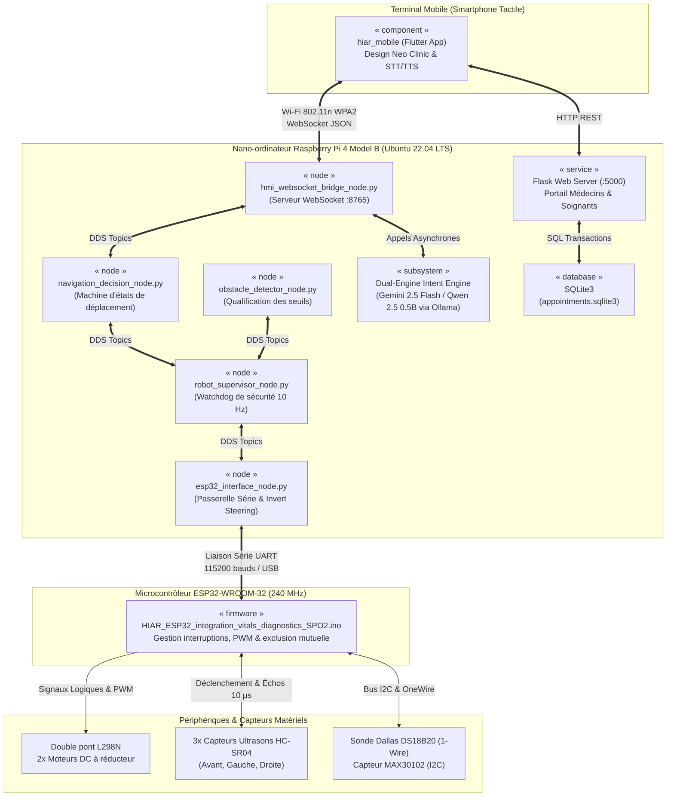
*Figure 22 : Diagramme de déploiement physique et logiciel du système distribué HIAR*

---

## 6.5. Sécurité, protection des données et conformité médicale

### 6.5.1. Sécurité fonctionnelle et défense en profondeur
La sécurité cinématique de HIAR est structurée selon un modèle de **défense en profondeur à 6 barrières étanches** :

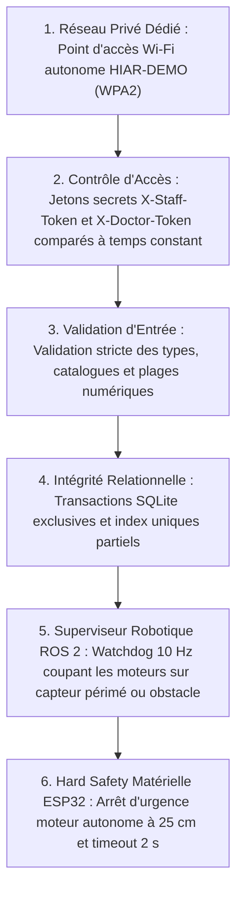
*Figure 23 : Modèle de défense en profondeur : couches de sécurité du réseau aux moteurs*

### 6.5.2. Analyse des menaces selon la méthodologie STRIDE

*Tableau 41 : Matrice d'analyse des menaces STRIDE appliquée à l'architecture HIAR*

| Catégorie STRIDE | Menace potentielle identifiée | Mesure de mitigation implémentée dans HIAR | Statut de validation |
| :--- | :--- | :--- | :--- |
| **Spoofing** *(Usurpation)* | Injection d'ordres par un tiers sur le réseau Wi-Fi. | Réseau Wi-Fi HostAP dédié protégé par WPA2 ; jetons secrets pour les API médicales. | **Validé** (Tests HTTP 401) |
| **Tampering** *(Altération)* | Modification concurrente des tickets de consultation. | Transactions SQL atomiques `BEGIN IMMEDIATE` et index uniques d'unicité. | **Validé** (Rejet doublons 409) |
| **Repudiation** *(Répudiation)* | Déprogrammation ou clôture non tracée d'une consultation. | Journalisation des créations, modifications de statuts et horodatages ISO 8601. | **Validé** (Logs d'audit serveur) |
| **Information Disclosure** | Divulgation publique indiscrète des signes vitaux mesurés. | **Non-vocalisation déontologique stricte :** la synthèse vocale (TTS) reste silencieuse sur les chiffres. | **Validé** (Protection secret médical) |
| **Denial of Service** *(Déni)* | Perte de liaison Wi-Fi bloquant le dialogue intelligent. | **Fallback automatique vers le LLM Edge souverain Qwen 0.5B local (Ollama).** | **Validé** (Continuum hors-ligne) |
| **Elevation of Privilege** | Commande directe des moteurs par un pirate via l'IHM. | Étanchéité absolue : l'IHM et l'IA ne peuvent jamais écrire sur `/robot/motor_command`. | **Validé** (Règle d'or respectée) |

### 6.5.3. Conformité à la réglementation malgache (Loi n° 2014-038 / CMIL)
Le recueil de données de contact et de constantes biométriques est strictement encadré par la **loi malgache n° 2014-038 du 9 janvier 2015 relative à la protection des données à caractère personnel**, sous l'égide de la **Commission Malagasy de l'Informatique et des Libertés (CMIL)** :
- **Principe de minimisation des données :** Le système n'exige aucun numéro de sécurité sociale ni identité civile complète : seul le numéro de téléphone servant d'identifiant de file est enregistré ;
- **Consentement éclairé et clauses de non-diagnostic :** Chaque écran de prise de constantes vitales et chaque fiche sanitaire affiche un avertissement juridique explicite rappelant que les mesures sont purement indicatives et ne se substituent aucunement à un examen médical clinique ;
- **Secret médical et éthique de non-divulgation :** À l'issue de l'acquisition des constantes, le robot s'abstient de prononcer les valeurs numériques à voix haute (*« Vos constantes s'affichent à l'écran »*), préservant l'intimité du patient en présence d'autres usagers dans le hall.

---

## 6.6. Moteur d'Intelligence Artificielle Hybride (Dual-Engine)

L'un des apports majeurs de ce travail réside dans la conception d'un **pipeline de compréhension du langage naturel (NLU) hybride et résilient** associant un modèle de fondation de grande taille hébergé dans le Cloud et un modèle compact souverain exécuté sur Edge.

### 6.6.1. Architecture du pipeline hybride à 3 étages
Le module `voice_intent_parser.py` traite les requêtes formulées textuellement ou par reconnaissance vocale (STT) selon une cascade décisionnelle optimisée :

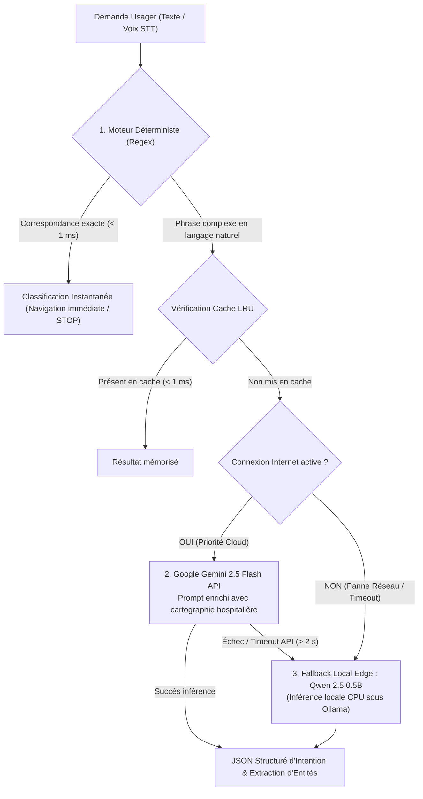
*Figure 24 : Architecture du moteur d'IA hybride à double niveau (Gemini 2.5 Flash + Fallback local Qwen)*

1. **Étage 1 (Moteur déterministe par expressions régulières) :** Intercepte les commandes réflexes critiques (ex: *« Stop »*, *« Arrête-toi »*, *« Va à la pharmacie »*) avec une latence sub-milliseconde ($< 1\text{ ms}$), éliminant tout appel superflu aux réseaux neuronaux.
2. **Étage 2 (Moteur principal Cloud : Google Gemini 2.5 Flash) :** Mobilisé pour comprendre les requêtes complexes, implicites ou indirectes (ex: *« J'ai de la fièvre et je voudrais voir un généraliste ce matin »*). Le modèle reçoit un prompt système intégrant la cartographie des services hospitaliers, le catalogue des motifs médicaux et les contraintes de formatage JSON.
3. **Étage 3 (Moteur de repli souverain Edge : Qwen 2.5 0.5B via Ollama) :** Si la connexion Internet de l'hôpital est défaillante ou si l'API Cloud dépasse un délai critique de 2 secondes, le gestionnaire d'intentions bascule de façon transparente vers le modèle open-source quantifié Qwen 2.5 (0.5 milliard de paramètres) exécuté localement sur les cœurs CPU du Raspberry Pi 4. Cette redondance garantit que le robot ne devient jamais muet ni inerte.

### 6.6.2. Diagramme de séquence du basculement hors-ligne (*Fallback*)

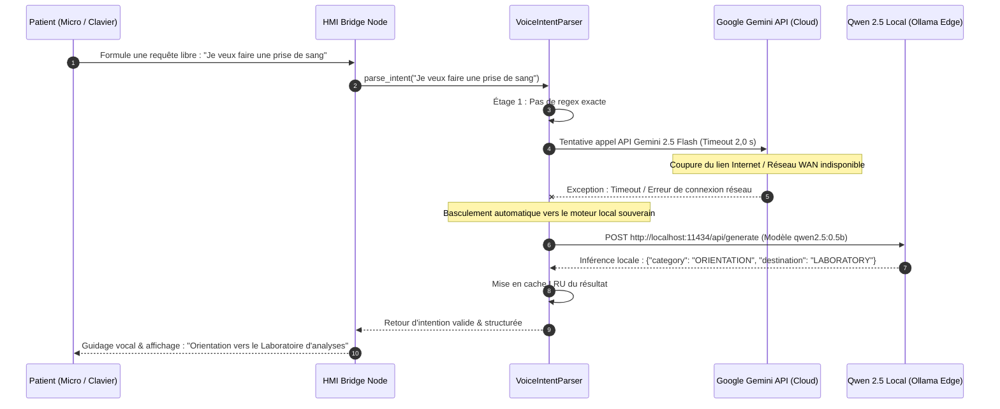
*Figure 25 : Diagramme de séquence du basculement automatique vers le moteur IA local hors-ligne*
